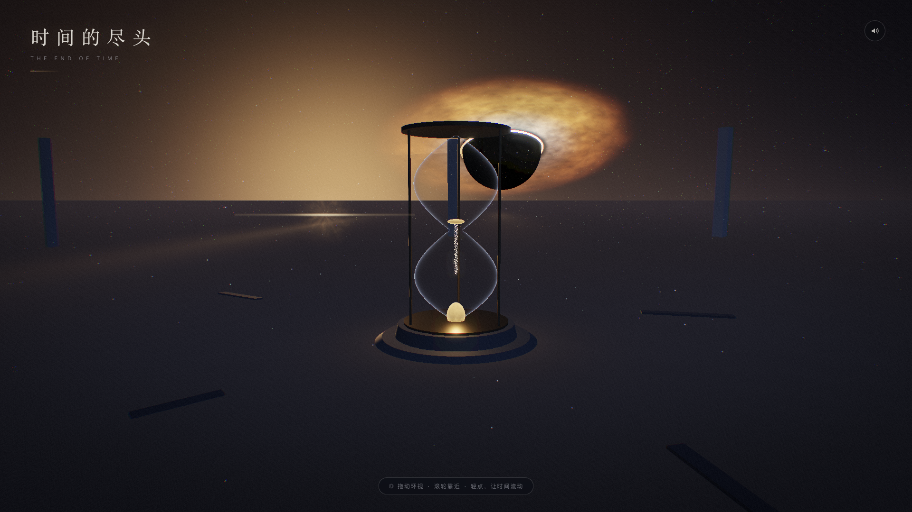

# 时间的尽头 · The End of Time

一个 Three.js 实时 3D 交互式沉浸短片：时间已经死去——一望无际的黑曜石镜面平原上，
矗立着最后一座沙漏纪念碑；地平线之上，一个巨大的黑洞正吞下最后一束光。
尘埃近乎凝固，只有你的注视与触碰，能让时间重新流动几秒，然后再度停住。



## 玩法 / 看点

- **拖动**环视整片荒原（带阻尼惯性 + 待机自动漂移 + 鼠标视差）
- **滚轮 / 双指捏合**推近拉远
- **轻点（或空格）唤醒时间**：全局"时间流速"从 0.14 的凝固基调冲到 1.6，
  吸积盘差速旋转、星尘漂移、沙粒坠落、星芒呼吸全部随之加速，随后指数衰减回凝固
- **声音开关**（右上角）：WebAudio 全合成的暗色氛围——低频 drone、气声、高泛音、
  偶发深潜 sub，且随"时间流速"一起呼吸膨胀
- 开场镜头由远处缓缓推近，标题与画面一同浮现

## 场景构成（全程序化，零模型/贴图资源）

- **黑洞**：纯黑事件视界 + 自定义着色器吸积盘（fbm 湍流、差速旋转、
  多普勒束射亮侧、内缘白热渐变）+ 光子环 + 引力透镜晕
- **最后一束光**：垂死的恒星——核心/光晕精灵、fbm 辐条星芒、
  anamorphic 横向拉丝、点光源与方向光
- **沙漏纪念碑**：Lathe 玻璃瓶身（菲涅尔玻璃着色器）、古铜框架、
  下瓶最后一小堆发光余烬沙、上瓶残沙、颈口悬停的 300 颗沙粒
  （凝固时悬停，时间流动时坠落）、底座琥珀光环
- **黑曜石镜面地面**：自定义着色器——黑洞与星光被拉长的倒影光路、
  纪念碑脚下的暖光池、方向性雾色与天空无缝衔接
- **氛围**：14k 冷色星尘 + 2.2k 暖色余烬粒子（着色器漂移 + 距离雾衰减）、
  远处倾斜的方尖碑柱与倒伏断碑、指数雾
- **后处理管线**：HalfFloat 渲染目标 → UnrealBloom →
  自定义调色 pass（ACES 胶片曲线 + gamma + 冷暖分级 + 色差 + 暗角 + 胶片颗粒）

## 技术要点

- three.js r128（UMD 本地化于 `vendor/`，含 EffectComposer/UnrealBloomPass 等后处理插件）
- `python3 build.py` 把 `src/shell.html + style.css + audio/scene/ui/main.js`
  与 vendor 库内联成**单文件 `index.html`（~687KB，零外部资源）**，`file://` 直接打开
- 全程线性空间渲染（NoToneMapping + LinearEncoding），最终调色 pass 统一负责
  ACES + gamma，避免双重色调映射
- 自研轨道相机（球坐标 + 阻尼 + 惯性 + 视差 + 触屏捏合），Pointer Events 统一鼠标/触屏
- 自适应画质：帧耗时持续超标时自动逐级降低渲染分辨率（pixelRatio 2 → 1）
- 坑位记录：GLSL 中 `pow(负数, 非整数)` 未定义会产生 NaN，
  曾经把吸积盘的多普勒项渲染成一块巨大黑色扇区——所有 pow 底数必须夹紧非负

## 目录

```
end-of-time/
├── build.py          # 单文件构建
├── index.html        # 构建产物（零外部资源，可直接打开）
├── src/              # shell.html / style.css / audio.js / scene.js / ui.js / main.js
├── vendor/           # three r128 UMD + 后处理插件 + LICENSE
└── shots/            # 预览与验收截图
```

## 测试情况

ego-browser 自动化验收，**全部通过、控制台全程零报错零警告**：

- 加载：遮罩淡出、canvas 渲染、桌面 1600×900 / 1920×1080 / 移动端 390×844（触屏 UA）三视口
- 交互：轻点 kick（flow 0.14 → 1.25 → 6 秒衰减回 ~0.2）、空格 kick、
  拖动环视（像素级前后对比确认视角变化）、滚轮缩放（同上）、
  触屏单指拖动（CDP touch 事件验证）、声音按钮开/关、9 秒后提示条淡出、resize 自适应
- 性能：1920×1080 实测 66fps（自动化浏览器内）
- `file://` 协议直开验证通过
- 着色器编译零错误（含一次 NaN 扇区事故的定位与修复，见上）

## 运行

```bash
cd end-of-time
python3 build.py   # 重新生成 index.html
open index.html    # 或任何静态托管
```
