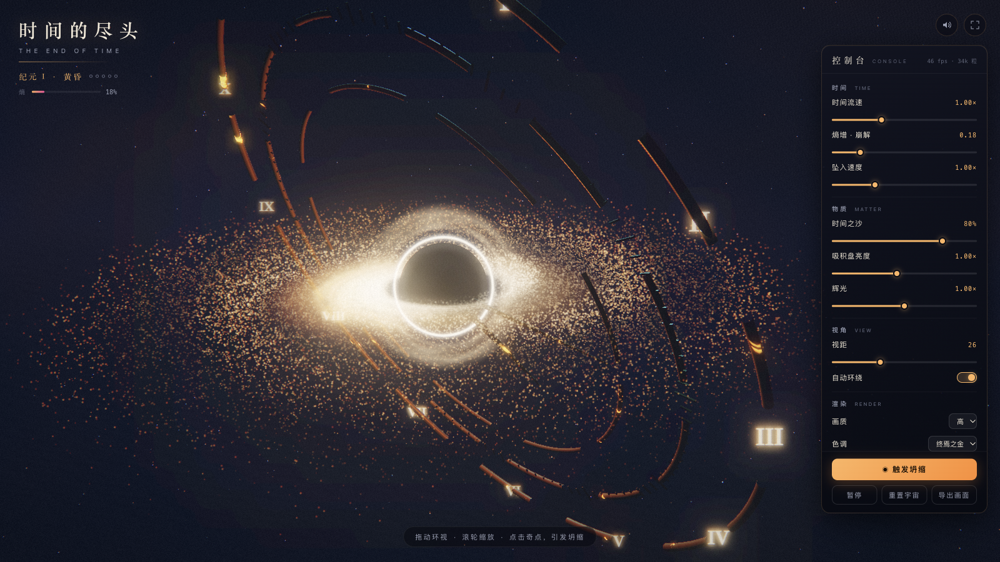

# 时间的尽头 · The End of Time

Three.js 实时 3D 交互作品 —— 一座正在崩解的宇宙时钟，悬在吞噬光线的黑洞之上。



**在线体验**: <https://case.youyongai.com/end-of-time/>

## 玩法

- **拖动**环视 · **滚轮 / 双指**缩放 · 鼠标视差 · 闲置 2.5s 后相机自动缓慢环绕
- **轻点奇点 / 空格 / 「触发坍缩」**：引发一次坍缩冲击波，宇宙向尽头推进一个纪元（黄昏 → 暮年 → 残响 → 余烬 → 终末之始）
- **5 次坍缩后抵达「终焉」**：时钟遗迹溶解成余烬、星河熄灭，只剩光子环与寂静；「重置宇宙」再来一次
- **控制台 10 项实时工具**：时间流速 / 熵增·崩解 / 坠入速度 / 时间之沙 / 吸积盘亮度 / 辉光 / 视距 / 自动环绕 / 画质三档 / 色调三主题（终焉之金 · 寂灭之冰 · 玫瑰余烬）
- 暂停（P）· 导出当前画面 PNG · 全屏 · 声音开关（WebAudio 全合成氛围，首次交互自动启动）

## 场景构成

- **黑洞**：纯黑事件视界 + 锐利光子环 + 引力透镜晕（billboard 上下镜像盘面）+ 自定义着色器吸积盘（fbm 湍流、`1/r^1.5` 差速旋转、多普勒束射亮 limb、温度色带）
- **时间之沙**：42,000 颗 GPU 粒子组成的螺旋星河，沿旋臂向奇点坠落，越坠越快、越靠近越亮
- **破碎时钟遗迹**：3 道断裂青铜环（种子随机缺口）+ 120 根实例化刻度 + 12 枚罗马数字 + 缓慢转动的时针分针；熵增时按 fbm 阈值逐块溶解，边缘烧出余烬光
- **氛围**：4,200 星野 + 尘埃层 + fbm 星云穹顶 + 坍缩时的双重冲击波环与 1,600 颗爆发余烬

## 技术要点

- three.js r128 本地化（vendor/），零运行时外部资源；`build.py` 把 `src/*` 打成单文件 `index.html`（~696KB），`file://` 双击可玩
- 线性空间渲染：所有调色板 hex 经 `convertSRGBToLinear()`，HalfFloat RT → UnrealBloom → 自定义调色 pass（ACES Narkowicz + gamma、色差、分离色调、暗角、胶片颗粒）
- 溶解材质：`MeshStandardMaterial.onBeforeCompile` 注入世界坐标 fbm discard + 余烬边缘自发光，兼容 InstancedMesh
- 自研阻尼轨道相机：球坐标 + 惯性 + 指针视差 + trauma² 震屏 + 开场推镜 + 画面偏移构图（黑洞偏左平衡右侧控制台）
- 自适应分辨率：帧时间 EMA 超阈值降 DPR、富余时回升；移动端默认中画质
- WebAudio 全合成：54/54.45Hz 拍频 drone、带通空气噪声、每秒 tick、坍缩噪声扫频 + 低频轰击
- 状态机驱动纪元推进，有效熵 = 滑杆熵 + 坍缩累积，终焉强制全溶解

## 目录

```
end-of-time/
├── index.html      # 构建产物（单文件，直接可玩）
├── build.py        # 打包脚本：python3 build.py
├── src/            # shell.html / style.css / audio.js / scene.js / ui.js / main.js
├── vendor/         # three r128 + 后处理 addons（本地化）
└── shots/          # 预览与回归截图
```

## 运行

直接双击 `index.html`，或 `python3 -m http.server` 后访问。修改 `src/` 后运行 `python3 build.py` 重新打包。

## 测试情况

ego-browser 4 轮回归共 **53 项全绿**，控制台全程零报错零警告：

- 桌面 1600×900：开场 veil 升起、渲染循环、拖拽环视 / 滚轮缩放 / 视差、点击奇点与空格坍缩、暂停/恢复（帧计数 + simTime 增量验证）
- 完整可玩循环：坍缩 ×5 → 终焉（全溶解熄灭）→ 重置复原；冷却期按钮禁用
- 控制台：6 滑杆实时生效、画质三档粒子数切换（11k/21k/34k 粒）、三主题截图比对、自动环绕开关、视距同步
- 导出 PNG 真实下载（9.7MB 1600×900）、全屏、声音首次手势启动与静音同步、提示 9s 淡出
- 手机 390×844 触屏：单指环视 / 双指缩放 / 底部抽屉控制台、提示不遮挡熵条；`file://` 协议直开验证

实测 SwiftShader 软渲染 ~46fps（真机 GPU 远高于此）；自适应分辨率在慢帧环境下自动降档保流畅。

> 初代方案（黑曜石荒原 + 沙漏纪念碑）已归档至 [`end-of-time-v1/`](../end-of-time-v1/)。