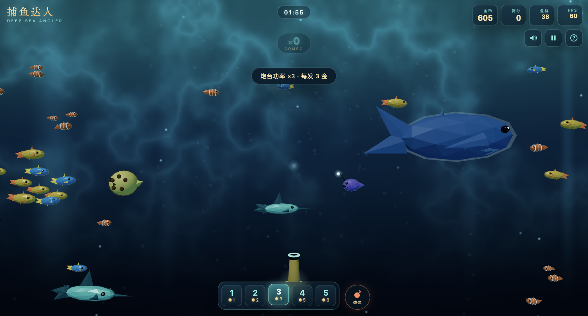

# 捕鱼达人 · DEEP SEA ANGLER

Three.js 实时 3D 捕鱼小游戏：深海水体里游着七种发光鱼，操纵黄铜炮台撒网，攒金币、连击与炸弹能量，在 2 分钟一局里刷出最高分。**零外部资源**，单文件 `file://` 双击即玩。



## 玩法

- **瞄准 / 撒网**：移动鼠标（触屏拖动）瞄准，点击或按住水面连续撒网；`Space` 也可发射。炮口会平滑跟随指针。
- **五档功率**：`1`~`5` 键或底部按钮切换，档位越高每发消耗越多（1/2/3/5/8 金），但网更大、捕获率更高。
- **七种鱼**：小丑鱼(2) → 蓝吊鱼(5) → 金鱼(10) → 河豚(20) → 旗鱼(50) → 灯笼鱼(100) → 座头鲸(500)；越稀有越重，低功率网住的概率越低。
- **连击倍率**：2.6 秒内连续命中，倍率从 ×1 升到 ×3（streak 2/4/7/11 递进），屏幕中央飘出金币与鱼名。
- **深水炸弹**：每捕获一条鱼充能 14，满 100 后按 `B` 或点右下炸弹，大范围清屏并爆出金币（击中的鱼会重新充能）。
- **一局 120 秒**：时间到弹出结算（本局得分 / 剩余金币 / 历史最佳），点「再来一局」重开；金币与最佳分存 localStorage，刷新不丢；金币有极缓慢的自然回复，不会弹尽粮绝。
- **其它**：`P`/`Esc` 暂停，右上角可静音、查看帮助；页面隐藏时自动暂停。

## 技术要点

- **Three.js r170 本地化**：`vendor/three.module.js` 去掉 ESM 导出后包成 IIFE 命名空间，`build.py` 把 CSS + 8 个 JS 模块内联进 `shell.html`，产出 **1.43 MB 单文件 `index.html`，零外部资源**。
- **全程序化视觉**：水体背景是自定义 GLSL 着色器（分层渐变 + fbm 焦散 + 6 道流动丁达尔光束 + 点状浮尘），鱼群由 `fish-art.js` 用球体/锥体/圆柱体程序化建模（背壳描边发光、白色竖纹/斑点/长吻/钓竿/鲸尾），辉光、渔网、金币纹理全部 `CanvasTexture` 现画。
- **轻量渲染**：鱼几何与材质按鱼种缓存（引用计数释放）、 Points 气泡 130 个、粒子上限受控、`devicePixelRatio ≤ 2`；ACES 色调映射 + sRGB 输出。
- **确定性玩法逻辑**：`logic.js` 是纯函数（加权抽鱼种、功率 vs 体重命中率、连击倍率、金币与炸弹结算），rng 可注入，被 node 回归与实机共用。
- **音频全合成**：`audio.js` 用 WebAudio 合成 9 种音效（开始/发射/捕获/金币/炸弹/连击/点击/庆祝/水下环境循环），首个手势解锁、静音开关、页面隐藏停 BGM，零音频文件。
- **响应式 HUD**：深海军蓝玻璃拟态面板 + 青色描边 + 金色衬线标题，桌面 / 390×844 竖屏 / 844×390 横屏三套布局，按钮 ≥44px、safe-area、无滚动。
- **测试钩子**：`window.__fm` 暴露 state/coins/score/streak/bomb/power/fishCount/errs 与 `fireAt`/`spawn`/`bombNow`/`setTime` 等方法，便于自动化回归；`?reset=1` 清档、`?muted=1` 静音、`?power=N` 设初始档位。

## 开发

```bash
cd fish-master
python3 build.py      # 重新生成单文件 index.html
node test/run.mjs     # 纯逻辑回归
open index.html       # 或任意静态托管
```

目录：`src/`（contract + 8 个模块）、`vendor/`（three r170 + MIT 许可）、`test/`（逻辑回归）、`shots/`（验收截图）。

## 测试情况

- **逻辑回归**：`node test/run.mjs`，**37 项断言全绿**（clamp / 命中率单调 / 注入 rng 的确定性判定 / 加权抽样的稀有度顺序 / 连击倍率 / 金币与炸弹边界 / 五档配置不变式 / 经济单调）。
- **浏览器回归**（ego-lite，单 TaskSpace，`file://` 实测）：启动画面 → 开始 → 定点捕获（金币、连击、飘字、炸弹充能）→ 4 连击 → 真实点击功率按钮 → 炸弹清屏（4 条鱼、+440 分）→ 暂停/继续 → 静音 → 结算/再来一局 → 刷新持久化，全程 `window.__fm.errs` 为空；桌面 1512×820 + 手机 390×844 + 横屏 844×390 三视口无溢出、按钮可达、HUD 无重叠，控制台零报错。
- **视觉验收**：多轮截图迭代修掉着色器「整格浮尘变方块」的渲染瑕疵、炮台被 HUD 遮挡与移动端计时器/统计重叠问题；最终截图见 `shots/`。
- **在线链接**：<https://case.youyongai.com/fish-master/>（已部署，桌面与手机竖屏冒烟通过）；本地 `index.html` 亦可双击即玩（零外部资源，无需服务器）。
