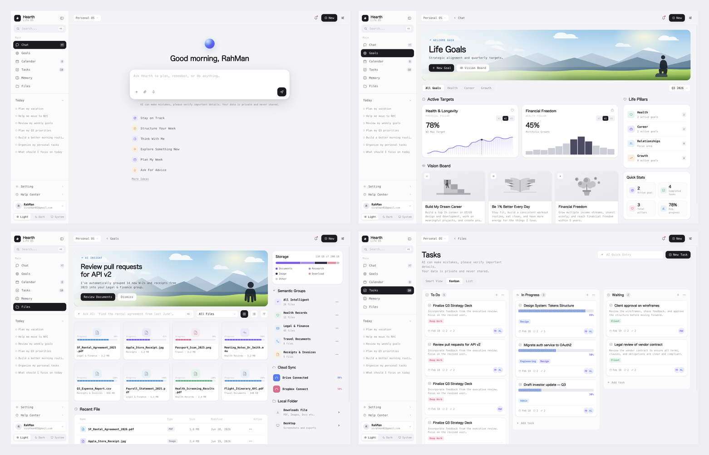

# Hearth · Life OS

> 参考图 1:1 网页复刻 —— 一个把 **Chat / Goals / Files / Tasks / Memory / Calendar** 收进同一层界面的「个人 AI 工作台」。
> 后端尚未接入，但**所有前端功能、按钮、交互都是真的能点的**。



---

## 1. 复刻了什么

参考图给了 4 张原型稿，本项目逐张 1:1 复刻，并把原型里「看起来能点但其实没接」的按钮全部补齐成真实交互。

| 原型 | 复刻结果 |
| --- | --- |
| **Chat 首屏** | 侧边栏（搜索 / 主导航 / Today 清单 / Setting / Help / 用户卡 / Light-Dark-System 主题条）、顶栏（工作区切换 / 通知 / New / 偏好）、渐变呼吸球 + `Good morning, RahMan`、大圆角输入卡（`+` 附件 / 回形针 / 麦克风 / 发送）、隐私提示、6 条灵感快捷指令 + `More Ideas` 展开 |
| **Life Goals** | 全景插画横幅（`WELCOME BACK` + `New Goal` + `Vision Board`）、`All Goals / Health / Career / Growth` 页签、`Q3 2026` 季度下拉、Active Targets 卡片（78% / 45% + W1·W2·W3 切换 + 曲线/柱状图）、Life Pillars 侧栏、Quick Stats 四宫格、Vision Board 三张插画卡 + 独立的看板视图 |
| **Files** | `AI INSIGHT` 横幅（`Review Documents` 流式总结 / `Dismiss`）、Ask AI 检索条、`All Files` 下拉、网格/列表切换、筛选菜单、文件卡（索引进度条）、Recent File 表格 + 行菜单、Storage 环形/条形 + 图例、Semantic Groups、云同步进度条、Local Folder |
| **Tasks** | `Tasks` 大标题 + 隐私说明、`AI Quick Entry`（流式解析）、`New Task`、Smart View / Kanban / List 三视图、看板列（计数徽标 + `+` / `⋮`）、任务卡（标签 / 截止日 / 评论 / 链接 / 负责人 / 条纹进度条）、**HTML5 拖拽换列**、任务详情抽屉 |

额外补齐（原型里是灰的但产品必须有）：`Calendar` 月视图、`Memory` 记忆卡、Setting / Help Center 抽屉、命令面板、通知中心、New 菜单、用户菜单。

---

## 2. 交互清单（全部可用）

**全局**
- 侧边栏 6 个主页面切换（hash 路由，浏览器前进后退可用）
- `⌘K` / `Ctrl+K` 命令面板：跨页面 / 文件 / 任务 / 目标 / 提示词搜索，↑↓ 选择、Enter 跳转
- `⌘T` 新会话 · `⌘J` 明暗切换 · `⌘N` New 菜单 · `Esc` 关闭任意浮层
- 侧边栏折叠成图标栏；Light / Dark / System 三档主题（System 跟随系统实时变化）
- 通知抽屉（标记已读 / 清空）、工作区切换（Personal / Work / Studio）、用户菜单
- 偏好抽屉：主题、紧凑模式、减少动效、隐私开关、导出、快捷键说明
- 主题、视图、目标、任务等状态写入 `localStorage`，刷新后保留

**Chat**
- 输入框自动增高；Enter 发送、Shift+Enter 换行
- **流式输出**：先走 `Thinking → Searching your memory → Checking goals & files → Drafting` 四段状态，再逐字吐出正文（带闪烁光标），结束后渲染成 Markdown（粗体 / 行内代码 / 有序无序列表）
- 消息操作条：复制 / 点赞 / 重新生成（重新生成会再流一次）
- 6 条灵感指令 + `More Ideas` 再展开 4 条；点击直接提问
- `+` 附件菜单（本地文件 / 从文件库取 / 链接目标）、回形针上传（真 file input）、麦克风（录音态动画 → 转写文本回填）
- 侧边栏 `Today` 的 7 条提示词点击后回填输入框

**Goals**
- 页签筛选、季度下拉、Pillar 点击筛选、Vision Board 开关（列表 ⇄ 看板）
- W1 / W2 / W3 切换：数值、指标名、图表数据同时变化
- 新建目标（名称 / 归属 / 目标值 / 指标 / 截止日），目标卡与 Pillar 计数实时联动
- 目标详情弹窗 + 进度滑杆 + 「Update progress」
- Vision 卡详情、状态切换（Planned / In Progress / Completed）、「Turn into a task」直接落进看板

**Files**
- `Review Documents` → **流式**读出 14 份文档的分组结论，末尾可一键生成 3 条任务
- `Dismiss` / `Show AI insight` 收起与恢复横幅
- Ask AI：输入回车 → **流式**给出检索结果，可直接跳到该分组
- 网格 / 列表切换、分组下拉筛选、筛选菜单、行菜单（打开 / 重命名 / 分享 / 下载 / 删除）
- 文件预览弹窗（类型 / 大小 / 分组 / 索引进度）、Storage 明细环形图、云同步条、Local Folder

**Tasks**
- Smart View / Kanban / List 三视图，状态记忆
- `New Task` 弹窗：标题、描述、所在列、截止日、标签多选、进度滑杆
- 看板列头 `+` 直接在该列建任务；`⋮` 列菜单（排序 / 折叠 / 清理）
- 任务卡点击进详情：改进度、换列、改标签；List 视图的勾选框真的能打勾
- **拖拽**任务卡在 To Do / In Progress / Waiting 之间移动，落位即计数更新
- `AI Quick Entry` 输入 → **流式**解析出标题 / 列 / 截止日 / 标签 → 确认落库

**Calendar / Memory**
- 月视图（今天高亮、事件气泡）、新建事件、`Upcoming` 列表、关联目标
- 记忆卡新增 / 查看 / 遗忘、自动捕获列表

---

## 3. 技术要点

- **零外部资源**：`build.py` 把 `src/*` 内联成单文件 `index.html`（约 218KB），没有图片、字体、三方库，`file://` 直接可开。
- **插画全部程序化**：山景横幅（天空渐变 + 三层山脊 + 云 + 绿色丘陵 + 独立的人物剪影层）、三张灰度 Vision 插画、曲线/柱状/环形图，全部是运行时生成的 SVG。
  - 人物单独成层（`preserveAspectRatio="xMidYMax meet"` + 绝对定位），所以横幅怎么拉伸人都不会变形。
- **设计令牌**：CSS 变量一套，Light / Dark 两套值，组件不写死颜色。
- **字体策略**：标题用 `ui-rounded`（SF Pro Rounded，复刻图里的圆体），正文/标签用 `ui-monospace`，全是系统字体，零字体文件。
- **逻辑与视图分离**：`src/logic.js` 是纯函数层（Markdown 渲染、回复匹配、任务增删改、目标周值、存储分段…），浏览器端和 Node 测试共用同一份源码。
- **零依赖**：没有 npm 依赖，没有构建工具链，Python 脚本打包。

---

## 4. 测试

| 层级 | 命令 | 结果 |
| --- | --- | --- |
| 逻辑层 | `node test/run.mjs` | **70 项全绿** |
| UI 层 | `ego-browser nodejs < test/ui.mjs` | **112 项全绿** |

UI 回归覆盖：外壳结构、Chat 全流程（含两次流式、复制/点赞/重生成、麦克风、附件）、六页导航、Today 回填、Goals（页签/周切换/新建/详情/看板/Pillar/季度）、Files（横幅收起恢复、流式复盘、网格列表、分组筛选、预览、Ask AI、存储明细）、Tasks（三视图、新建、详情、勾选、**拖拽换列**、AI Quick Entry）、命令面板、通知、New 菜单、OS 切换、设置抽屉、主题切换、侧边栏折叠、Calendar / Memory、**390px 与 900px 两档响应式无横向溢出**、**控制台零报错**。

```bash
cd hearth-workspace
python3 build.py            # 打包成单文件 index.html
node test/run.mjs           # 逻辑层回归
python3 -m http.server 8931 # 起本地服务
ego-browser nodejs < test/ui.mjs   # UI 回归（需服务已启动）
```

---

## 5. 目录

```
hearth-workspace/
├── build.py            # 打包脚本
├── index.html          # 产物（单文件，零外部资源）
├── src/
│   ├── shell.html      # 外壳骨架
│   ├── style.css       # 设计令牌 + 组件样式（响应式断点 1180/1024/900/720/520）
│   ├── icons.js        # 内联 SVG 图标集
│   ├── art.js          # 程序化插画与图表
│   ├── data.js         # 种子数据 + 状态仓库
│   ├── logic.js        # 纯逻辑层（与测试共用）
│   ├── core.js         # 路由 / 侧边栏 / 主题 / 浮层 / 命令面板
│   ├── chat.js  goals.js  files.js  tasks.js  extra.js   # 各页面
│   └── boot.js         # 视图注册 + 启动
├── test/
│   ├── run.mjs         # 逻辑层回归（70 项）
│   └── ui.mjs          # UI 回归（112 项）
└── shots/preview.png
```

---

## 6. 在线体验

<https://case.youyongai.com/hearth-workspace/>
