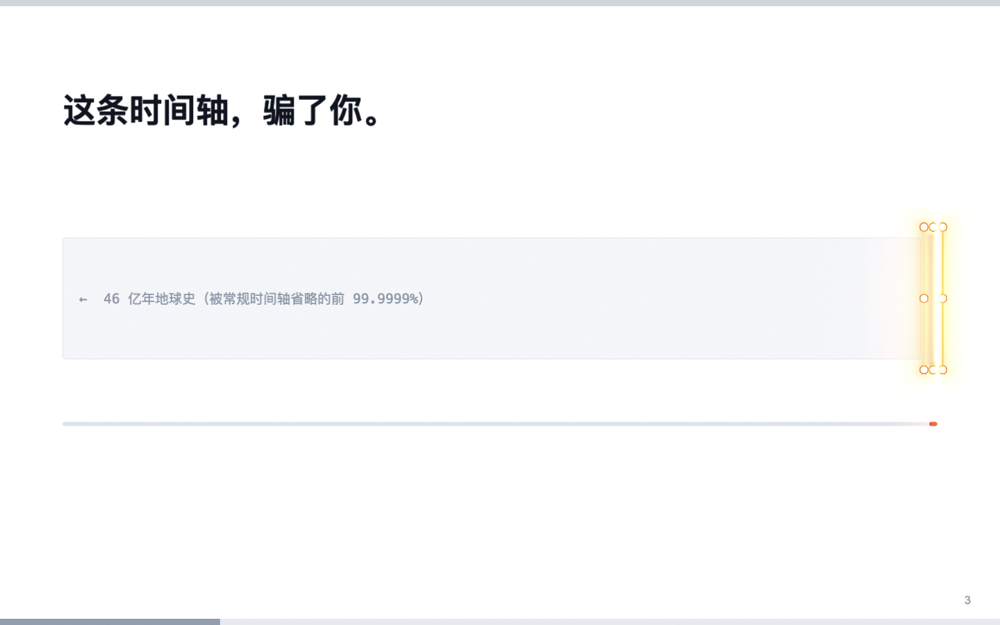
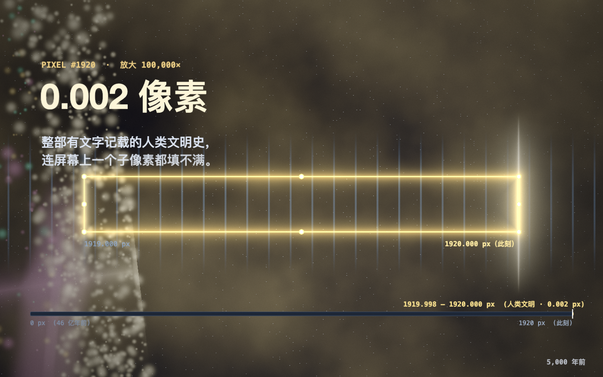
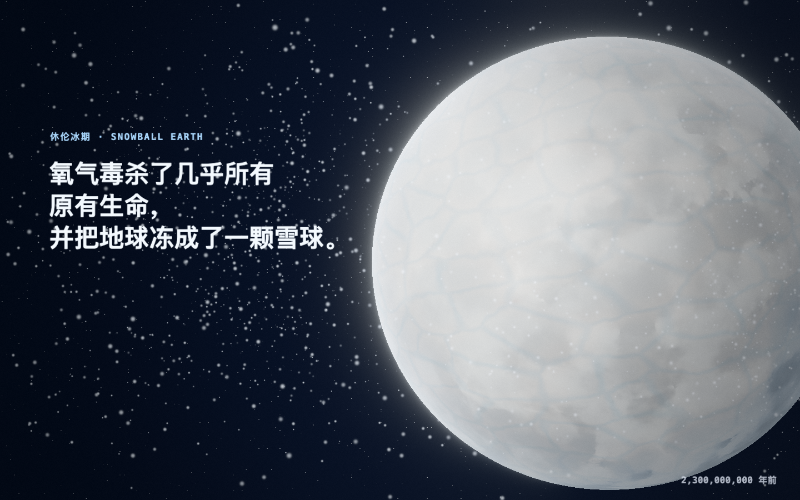
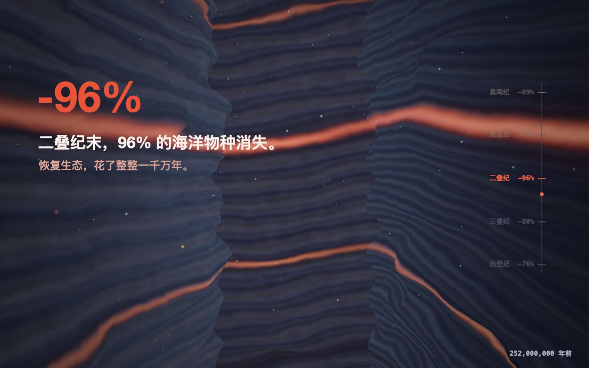
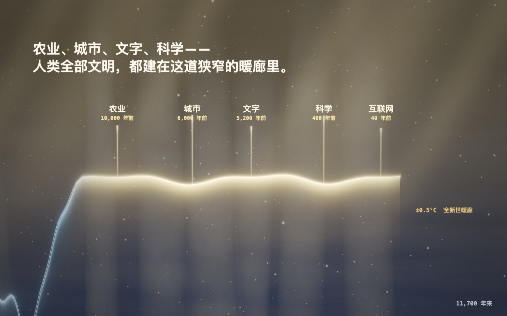
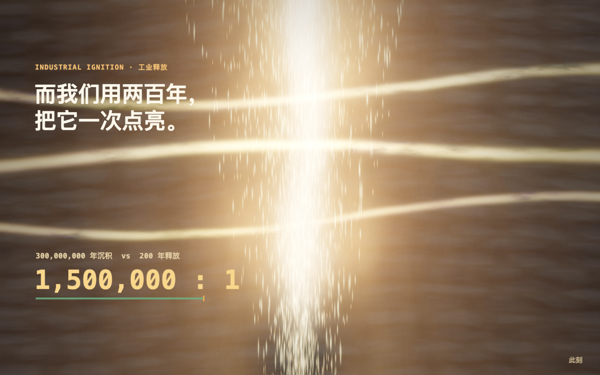
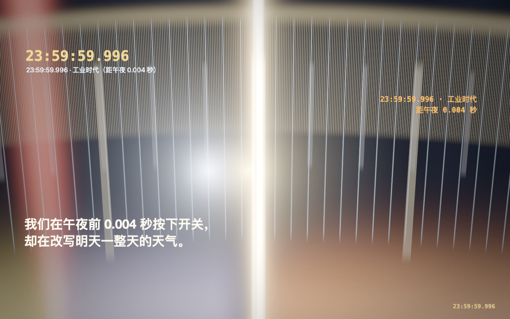
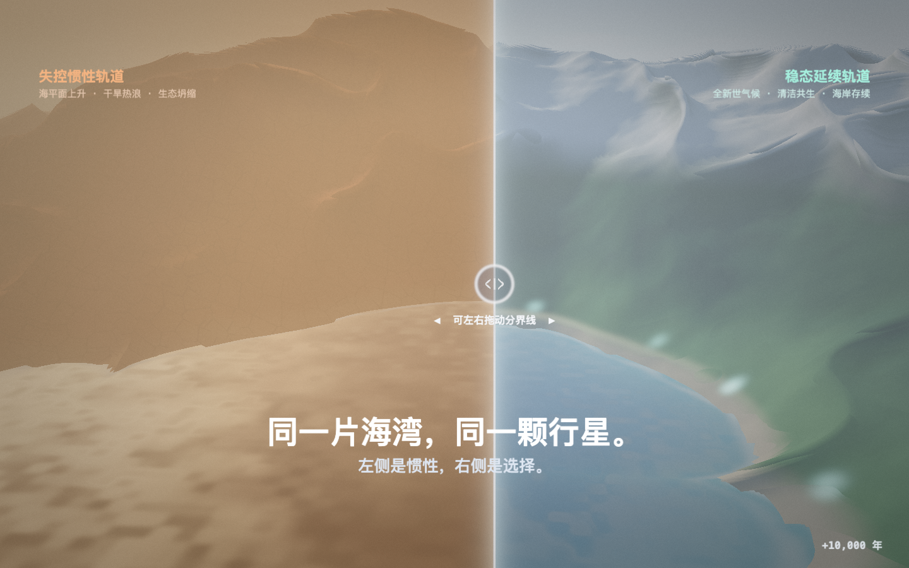
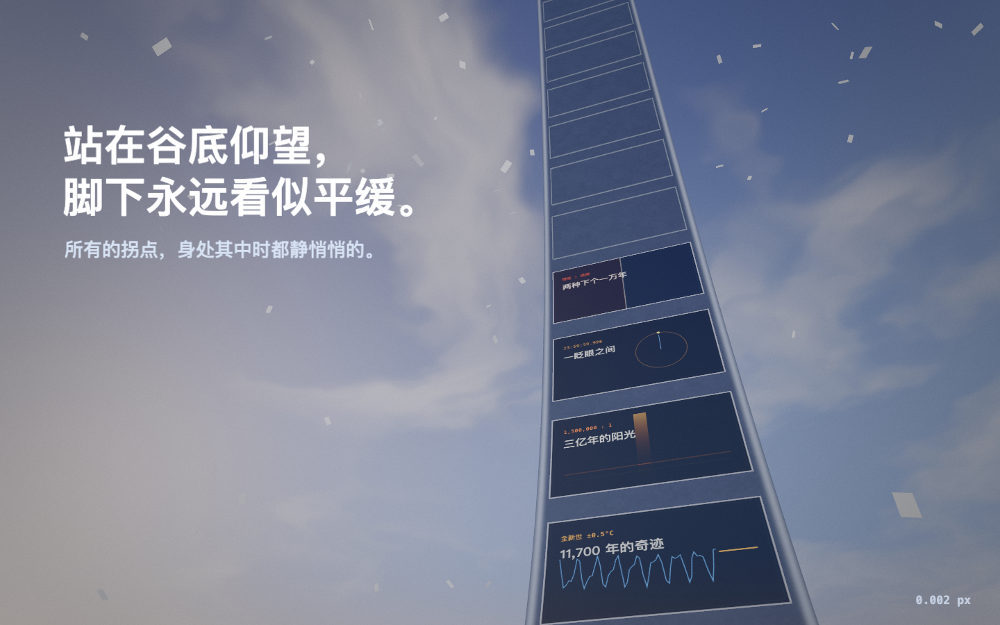
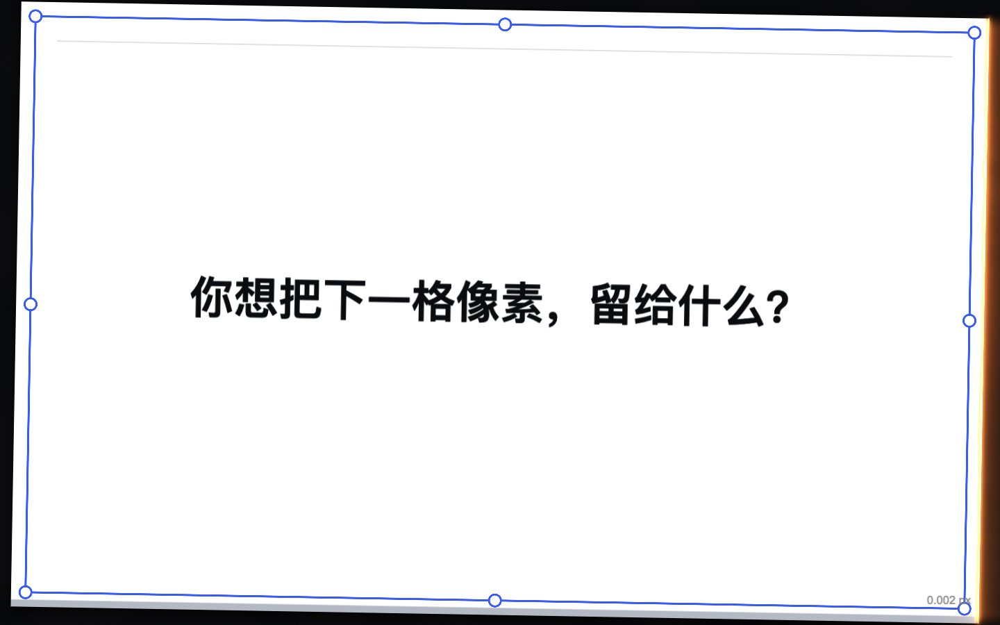

# 最后半个像素 · The Last Half Pixel

> 把地球 46 亿年压成一根 1920 像素的进度条，整部有文字记载的人类文明史，只占最右端的 **0.002 像素**。

**在线体验**：<https://case.youyongai.com/last-half-pixel/>  
**离线运行**：直接双击打开单文件 [`index.html`](./index.html)（~1.71 MB，零外部网络资源，`http://` 与 `file://` 均可运行，需支持 WebGL 2 的现代浏览器）

---

## 核心观点与切入点

这是一份以 **「形式即论点（Form IS the Argument）」** 为设计原则创作的原创 WebGL 2 电影级中文交互演示文稿：

- **打破第四面墙的开场**：演示文稿以一张极其平淡的白底教科书式 PPT 开场——把「原始社会 / 农耕时代 / 工业革命 / 信息时代 / 未来展望」排成五个等宽方块。随后一个钴蓝色 PPT 选中框自行接管画面，改写标题为 **「这条时间轴，骗了你。」**，将整部人类史向右猛烈压缩成屏幕右边缘一道不足 1 像素的炽热细缝，再潜入真实比例的地球深时（Deep Time）三维世界。
- **核心叙事线索**：在地球 46 亿年里，前 1,690 个像素只有微生物；一次蓝藻释放氧气就曾把地球冻成雪球；岩层里刻着五次大灭绝的伤疤（二叠纪末 96% 海洋物种消失）；过去 40 万年气候剧烈震荡，直到 11,700 年前才意外出现极其平稳的全新世暖廊（±0.5°C），人类全部农业、城市、文字与科学都建在这条狭窄暖廊里；而我们用两百年释放了三亿年石炭纪封存的阳光，在地球 24 小时时钟的 **23:59:59.996（午夜前 0.004 秒）** 按下了开关。
- **首尾呼应的收尾**：最后一幕回到开场那张白底「感谢聆听 · Q&A」模板，选中框再度接管，留下全片唯一的问题——**「你想把下一格像素，留给什么？」** 随后整页白底幻灯片在右边缘裂开一道炽热琥珀色地质缝隙，向漆黑虚空缓缓倾斜 **1°** 定格。

---

## 10 幕内容结构

| 幕次 | ID | 标题 | 物理转场 | 核心画面与论点 |
| --- | --- | --- | --- | --- |
| 01 | `boring` | 人类历史概览 | `fade` | 白底 PPT 开场 → 五个等宽历史方块 → 蓝色 `SelectBox` 自行接管、压扁整部人类史并切入深时蒙太奇 |
| 02 | `scale` | 1920 像素的地球 | `line` | 3D 深空天文标尺与 14,000 颗 GPU 地层粒子，从冥古宙岩浆一路推进，100,000× 显微放大第 1920 像素揭示 **0.002 像素** |
| 03 | `breath` | 第一次呼吸 | `wash` | 程序化 3D 光线步进地球：太古宙蓝藻释放氧气 → 铁条带锈红 → 休伦冰期雪球地球 → 火山裂隙解冻蓝海 |
| 04 | `five` | 五次清零 | `flaps` | 垂直潜入 3D 层理岩壁峡谷与 18,000 颗发光生物萤火，穿越二叠纪大灭绝（-96%）岩浆伤疤时 96% 粒子成片熄灭 |
| 05 | `window` | 11,700 年的奇迹 | `daybreak` | 冰芯光柱大厅中的 3D 古气候温度曲线：40 万年 ±8°C 冰蓝锯齿骤然收平为 ±0.5°C 金色全新世暖廊与 5 座文明地标针 |
| 06 | `coal` | 三亿年的阳光 | `slam` | 石炭纪森林体积光沉积 → 地壳高压封存煤油脉 → 工业时代垂直能量喷泉爆发与 **1,500,000 : 1** 对数计数器 |
| 07 | `flicker` | 一眨眼之间 | `fold` | 深空中的黄铜黑曜石 24 小时地球时钟，从 00:00 扫过 23:59:56（智人）直抵午夜前 **0.004 秒**（23:59:59.996）微距颤动指针 |
| 08 | `split` | 两种下个一万年 | `tear` | **可交互分屏**：单遍同步光线步进海湾地形，左侧失控惯性轨道（干涸红土/海平面上升）vs 右侧稳态延续轨道（碧海苍林），**支持左右拖拽分界线** |
| 09 | `zoom` | 你在此处 | `portal-in` | 3D 指数级深时悬崖高墙，悬浮展示各幕实时快照画板与今日日期，抬头仰望静悄悄到来的拐点 |
| 10 | `ending` | 感谢聆听 | `portal-out` | 回到白底「感谢聆听 · Q&A」→ `SelectBox` 接管改写为「你想把下一格像素，留给什么？」→ 全屏选框扩张、右侧裂开琥珀色缝隙并倾斜 `-1°` |

---

## 技术要点

- **WebGL 2 / Three.js r170 管线（`src/gfx.js`, `src/deck.js`）**：
  - 全链路线性 HDR 渲染（`RGBA16F` HalfFloat 目标 + 自动回退），内置 6 级 Dual-Kawase / 13-tap 辉光（Bloom）、AgX / ACES 色调映射、色差（CA）、光晕（Halation）、暗角、胶片颗粒与三角抖动输出。
  - 动态分辨率缩放（DRS 四档 `[1.0, 0.84, 0.70, 0.58]`）、非活跃场景 RenderTarget 自动 `park` 缩容至 `2×2` 省显存、启动期着色器预热进度条（`warmAll`）。
- **10 种物理 GLSL ES 3.00 转场（`src/transitions.js`）**：
  - `fade`、`line`（狭缝扫描坍缩成发光时间弦）、`wash`（海浪拍打玻璃折射 + Worley 泡沫 + 滑落水珠）、`flaps`（3D 实例化岩层翻页牌）、`daybreak`（猫眼散景虚焦与光斑）、`slam`（岩石印章重击与冲击波）、`fold`（4×2 折纸精准折叠入下一幕 `anchor()`）、`tear`（3D 沿中线撕开纸张 + 纤维毛边 + 48 片坠落碎纸）、`portal-in`、`portal-out`。
- **GPU 实例化中文排版引擎（`src/type.js`）**：
  - Canvas2D 动态字形图集（纯系统与 CJK 回退字体栈，零外部字体文件）+ `THREE.InstancedBufferGeometry` 批量渲染，支持中文避头尾标点换行、7 种逐字/逐词/逐行入场动效（`rise`/`blur`/`type`/`fade`/`scatter`/`track`/`drop`）及 3D 空间排版（`.in3D()`）；配套着色器渲染的 `SelectBox`（8 控制柄 + 旋转钮）与 SDF `Rect2D`。
- **全程序化 WebAudio 合成引擎（`src/audio.js`）**：
  - 零音频文件，手写 Cytomic TPT 状态变量滤波器（SVF）、阻尼模态谐振器、纤维撕裂噪声与非阻塞离线缓冲合成；内置 19+ 种场景音效（打字/选中/挤压/雪崩/大灭绝冲击/秒针滴答/海浪/撕纸/重击等）、6 路平滑参数总线与 D 调泛音列动态铺底，并兼容无音频/无头浏览器环境。
- **单文件零依赖构建（`build.py`）**：
  - 本地内联 `vendor/three.module.js`（Three.js r170）与全部 `src/*.js`、`src/template.html` 打成单一 `index.html`（~1.71 MB），无任何 `http://`/`https://` 运行时依赖。

---

## 快捷键与交互说明

| 操作 / 快捷键 | 功能 |
| --- | --- |
| `→` / `↓` / `空格` / `Enter` / 左键点击 / 左滑 | 下一节拍或下一幕 |
| `←` / `↑` / `Backspace` / 右键 / 右滑 | 上一节拍或上一幕 |
| **Scene 8 拖拽中线**（`◀ \| ▶`） | 实时左右对比「失控惯性」与「稳态延续」两种未来（拖拽不误触翻页） |
| `N` | 开关内置中文演讲者备注栏 |
| `P` | 打开独立演讲者备注同步窗口 |
| `O` | 打开 10 幕幻灯片缩略图总览网格（点击跳转） |
| `F` | 切换全屏放映 |
| `A` | 开关自动播放模式 |
| `M` | 静音 / 恢复程序化配乐与音效 |
| `.` 或 `B` | 黑屏 / 恢复画面 |
| `?` 或 `H` | 开关快捷键帮助面板（`Esc` 关闭浮层） |
| `#<scene>-<beat>` / `?quick` | URL 直达任意幕与节拍（如 `#split-1`）；`?quick` 跳过启动预热动画 |

---

## 预览图

| 01 · 时间轴接管 | 02 · 1920 像素与 0.002 px |
| :---: | :---: |
|  |  |

| 03 · 第一次呼吸（雪球地球） | 04 · 五次清零（二叠纪 -96%） |
| :---: | :---: |
|  |  |

| 05 · 11,700 年全新世暖廊 | 06 · 三亿年的阳光（1,500,000:1） |
| :---: | :---: |
|  |  |

| 07 · 23:59:59.996（午夜前 0.004 秒） | 08 · 两种下个一万年（可拖拽分屏） |
| :---: | :---: |
|  |  |

| 09 · 你在此处（指数深时悬崖） | 10 · 下一格像素（裂隙与 -1° 倾斜） |
| :---: | :---: |
|  |  |

- 竖屏移动适配实拍：[mobile-portrait.png](./shots/mobile-portrait.png)（390×844）

---

## 测试回归情况

- **Node 逻辑 / 构建 / 契约回归（[`test/run.mjs`](./test/run.mjs)）**：**10 / 10 全绿**
  - 全源码 `node --check` 与 `build.py` `py_compile` 语法校验、单文件打包产出校验、零外部 `http(s)` 运行时资源及 `file://` 兼容性校验；`LHP.math` 数学/单调样条/确定性 PRNG/GLSL 块单测、`LHP.createAudio` 无头安全与全 SFX/参数契约、10 种物理转场、10 幕顺序/节拍与全中文演讲备注全覆盖。
- **ego-browser UI 与 WebGL2 视觉回归（[`test/ui-verify.mjs`](./test/ui-verify.mjs)）**：**13 / 13 全绿**（全程零 `console.error` / `pageerror` / GLSL 着色器编译与链接报错）
  - 逐幕 `seek` 验证全 10 幕非空白像素方差与 44 组差异色板并人工逐张核验全部 11 张实拍截图；
  - 逐一验证全部 9 个物理转场中点（`p = 0.5`）零着色器报错；
  - 真实鼠标拖拽 Scene 8 分界线验证画面像素显著变化且不误翻页；
  - 完整验证 `ArrowRight`/`ArrowLeft`、`N`、`O`、`.`、`?`、`A`、`M` 全部演讲控制快捷键；
  - 验证桌面端 `1440×900`、手机竖屏 `390×844` 无横向溢出与离线 `file://` 直接打开运行。
