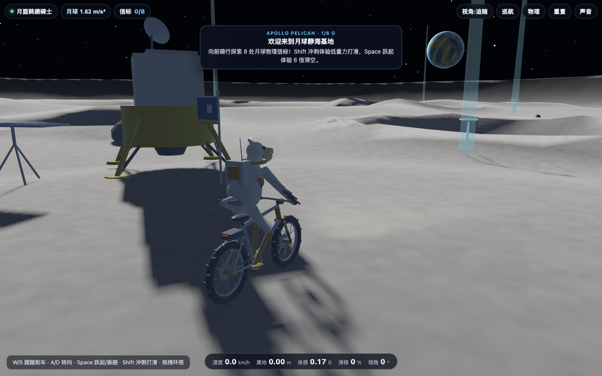
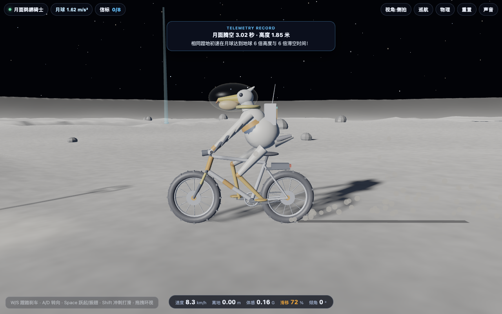
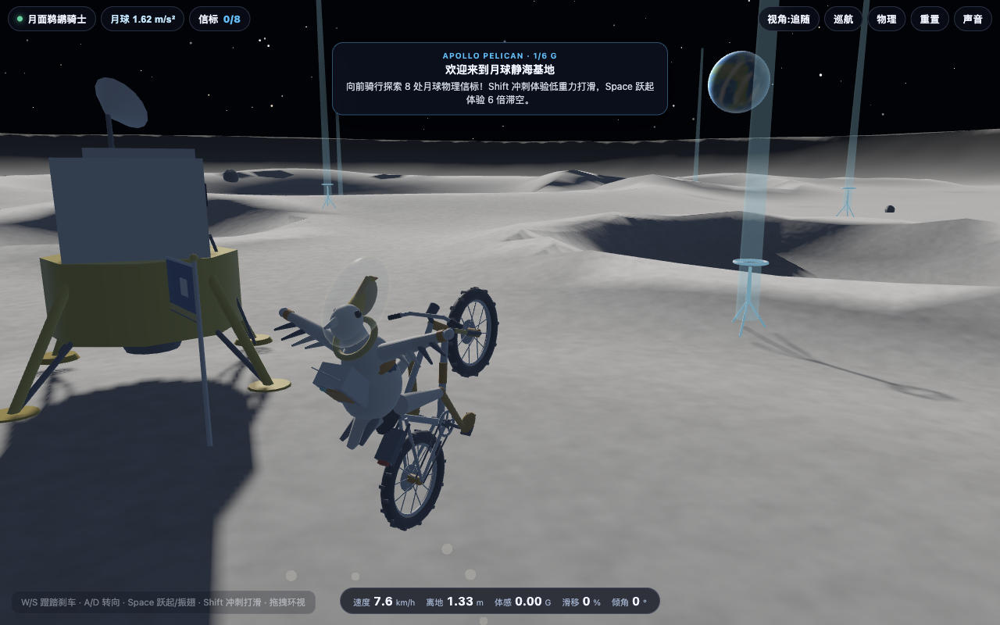
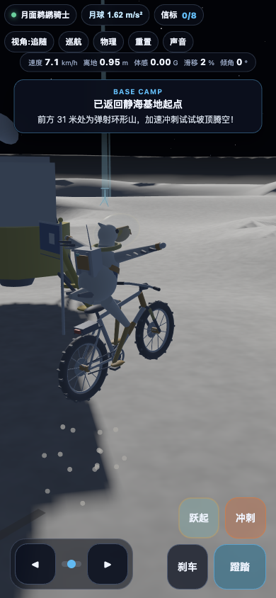
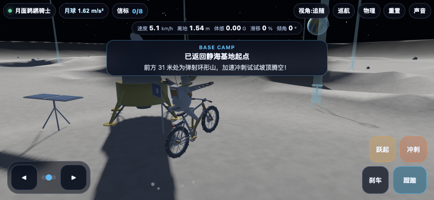

# 月面鹈鹕骑士 · Lunar Pelican Cycle

一只戴着透明宇航头盔的鹈鹕宇航员，在月球静海基地骑行自行车并探索 **8 处月球物理规律信标** 的实时 3D WebGL2 交互体验（支持 **电脑 PC 键鼠** 与 **手机触屏** 竖/横屏游玩，零外部依赖，单文件离线可直接打开）。

- **在线体验**: <https://case.youyongai.com/lunar-pelican-cycle/>
- **离线运行**: 直接双击打开 [index.html](./index.html)（`154.8 KB` 单文件零外部依赖）

---

## 玩法与操作

骑行穿过静海基地、弹射环形山与第谷大环形山，收集 **8 处月球物理信标**，也可随时在右上角打开「物理」实验面板实时切换 **月球真空 (`1.62 m/s²`)** 与 **地球对照 (`9.81 m/s²`)** 直观对比物理差异。

### 电脑端（PC 键鼠）
- `W` / `↑`：蹬踏加速
- `S` / `↓`：刹车减速（近静止时可轻倒车）
- `A` / `D` 或 `←` / `→`：左右转向与压弯
- `Shift`：全力冲刺（极易突破 1/6 重力后轮抓地极限并扬起弹道月尘）
- `Space`：蓄力跃起（腾空时再按可真空振翅，严格无升力）
- 鼠标左键拖拽：环视视角；滚轮缩放
- 快捷键：`C` 切换视角（追随 / 侧拍 / 环月） · `G` 切换月球/地球环境 · `P` 自动巡航 · `R` 重置起点 · `M` 静音

### 手机端（触屏竖屏 / 横屏）
- 左下角方向滑舵：点按左右箭头或横向推滑控制转向
- 右下角操作区：`蹬踏`、`刹车`、`冲刺`、`跃起` 支持多指同时按住操作
- 画面区域单指划屏可环视视角，双指捏合可缩放距离

---

## 核心模拟物理规律

1. **1/6 重力跃起与滞空 ($g = 1.62\text{ m/s}^2$)**: 相同蹬地起跳初速下，月球跃起高度（~1.85 m）与滞空时间（~3.02 s）均为地球对照模式（~0.31 m / ~0.50 s）的 **6 倍**。
2. **坡顶离心临界起飞 ($v^2\kappa > g\cos\theta$)**: 高速越过环形山凸起坡顶时，所需向心加速度超过重力法向分量，地面支持力归零，自行车自然抛物腾空。
3. **低重力抓地极限与打滑 ($F_{\max} = \mu N$)**: 月面正压力仅为地球 1/6，按住冲刺大扭矩输出会突破最大静摩擦，引发后轮高速空转（遥测滑移率飙升并亮起琥珀告警）。
4. **真空零风阻与超长滑行 ($F_{\text{drag}} = 0$)**: 空气密度 $\rho = 0$，停止蹬踏后没有气动阻力，仅靠低正压力下的微弱月壤滚阻缓慢减速。
5. **真空弹道扬尘与无升力振翅**: 无大气浮力与紊流，轮胎甩出的月尘沿精准抛物线落回月面后立即静止，不会漂浮成烟云；空中拍打翅膀仅有动作而垂直加速度严格保持 $-g$。
6. **腾空角动量守恒 ($\Delta L_{\text{bike}} = -\Delta L_{\text{wheel}}$)**: 离地后空中踩踏加速后轮会借反作用力矩抬高车头，捏闸刹车会压低车头。
7. **慢动作压弯平衡 ($\omega \propto \sqrt{g/h}$)**: 倒立摆侧倾与回正频率约比地球慢 $2.46$ 倍。
8. **0 G 自由落体与喉囊浮起**: 离地瞬间体感重力跌至 `0.00 G`，鹈鹕喉囊弹簧质子随失重向上浮起。

---

## 技术实现

- **纯原生 WebGL2 (GLSL ES 3.00) 零依赖引擎**: 不引入任何第三方 3D 库，全部向量/矩阵数学、程序化 3D 网格（自行车架/避震前叉/花键胎/鹈鹕躯干/弯钩长喙/喉囊/透明玻璃头盔/双翼/登月舱/太阳翼/玄武岩块/地球球体）与 Shader 内建于 [src/](./src/)。
- **月球光伏散射与阴影**: 地形采用 **Lommel-Seeliger 月壤光度模型 + 冲日效应（Opposition Surge）+ 一致频微凹凸法线 + 1024×1024 3×3 PCF 阴影贴图**，配合地球微弱蓝光照亮背光暗面，无空气散射雾化（地球对照模式自动开启天蓝大气与风阻）。
- **解析 2-Bone 逆向运动学（IK）**: 鹈鹕大腿/小腿/蹼足通过 2-Bone IK 实时严密锁定在旋转脚踏板上。
- **头盔内 WebAudio 合成音效**: 仅保留车架-月面结构传导的低频滚动与打滑摩擦声，一旦离地跃起立刻切换为真空寂静，着地与信标发现触发低频震动与遥测提示音。
- **单文件离线打包**: `build.py` 零外部依赖合并压缩内联所有 CSS 与 JS，生成单文件 [index.html](./index.html) 并通过 `node --check` 语法与零外链校验。

---

## 自动化测试结果

- **物理与逻辑回归 ([test/physics.test.mjs](./test/physics.test.mjs))**: `node lunar-pelican-cycle/test/physics.test.mjs` — **17 项核心物理与世界规则回归全绿**（涵盖 1/6 重力 6 倍跃起比、真空零风阻、低重力打滑、长刹车距离、坡顶临界起飞、空中反作用力矩抬头/压头、真空振翅零升力、精确弹道月尘、0G 喉囊漂浮、内倾压弯速率比、360° IK 无 NaN 闭环校验、信标与碰撞确定性）。
- **UI 与多端视觉回归 ([test/ui.e2e.mjs](./test/ui.e2e.mjs))**: 使用 `ego-browser` 实测 — **12 项桌面端（1280×800）、手机竖屏（390×844）、手机横屏（844×390）与 `file://` 离线加载回归全绿**，60 FPS 零控制台报错、零布局重叠。

| 桌面端主视角 | 桌面端 0 G 腾空 | 手机竖屏 | 手机横屏 |
| :---: | :---: | :---: | :---: |
|  |  |  |  |
