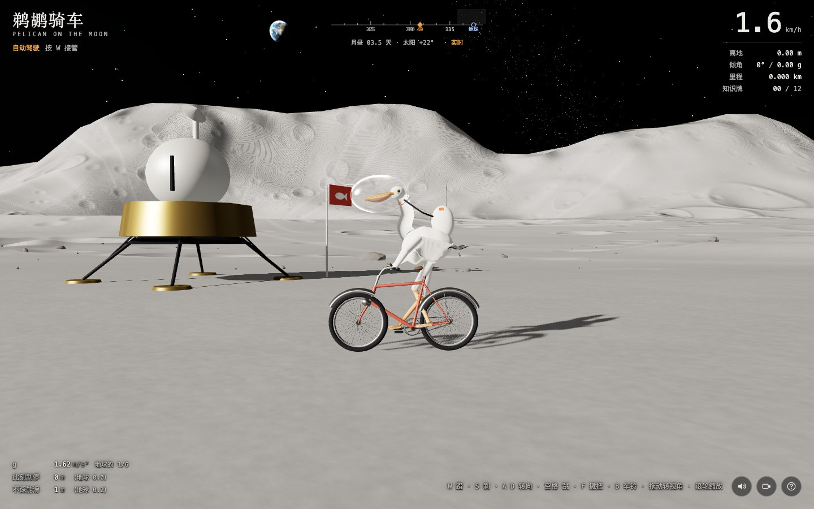
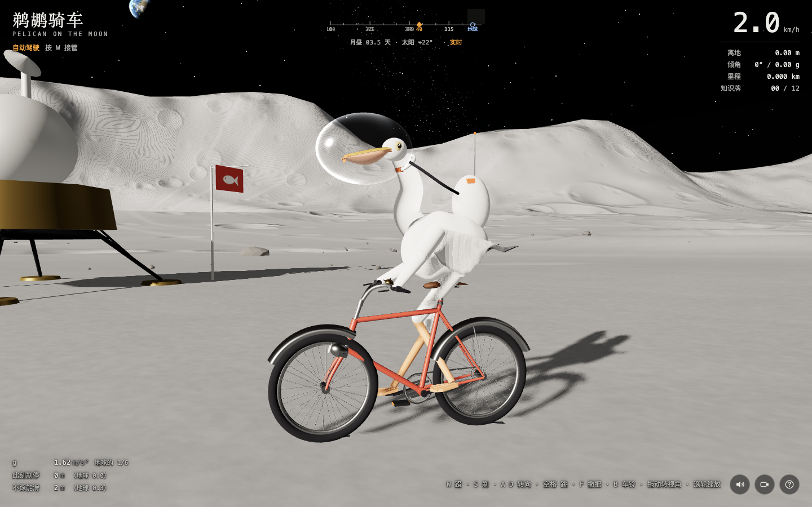
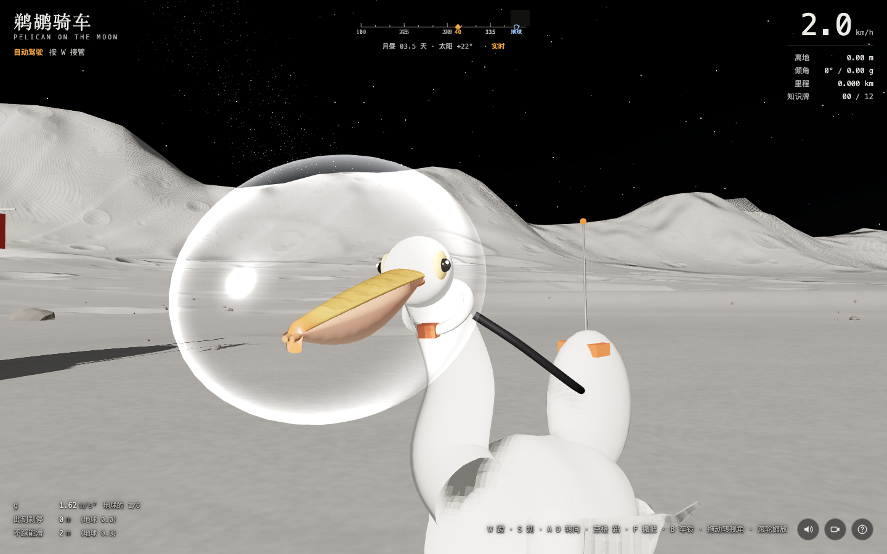
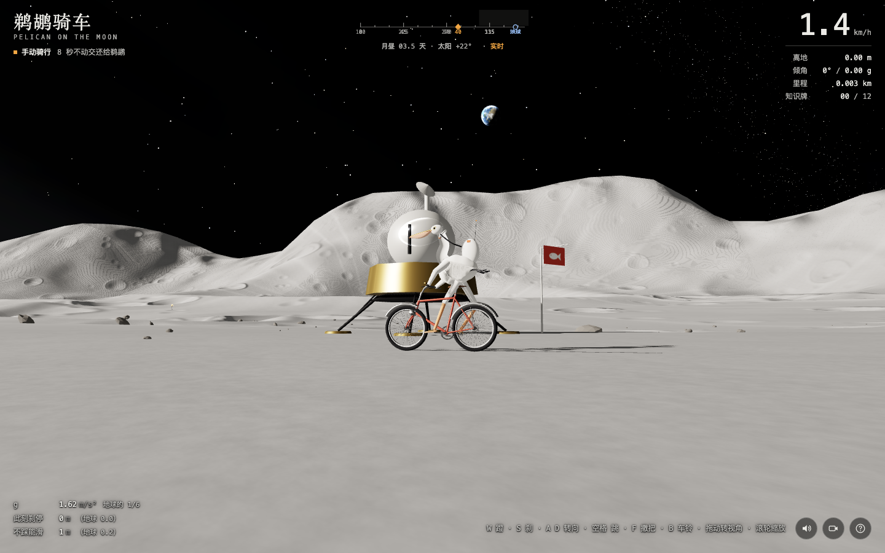
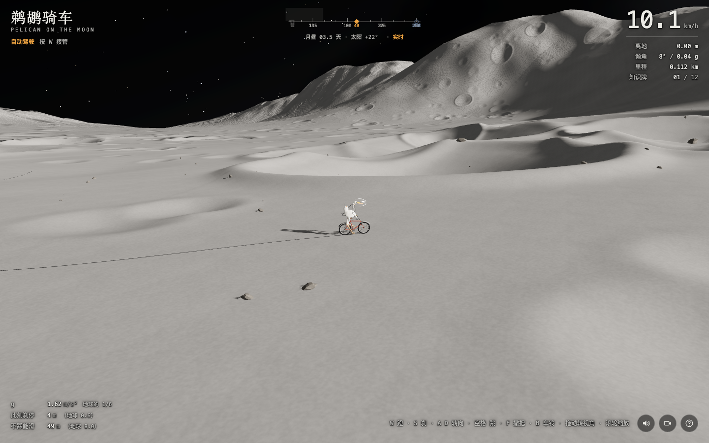
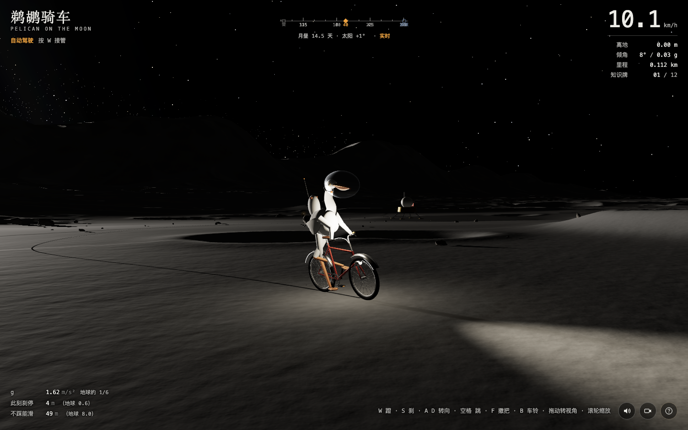
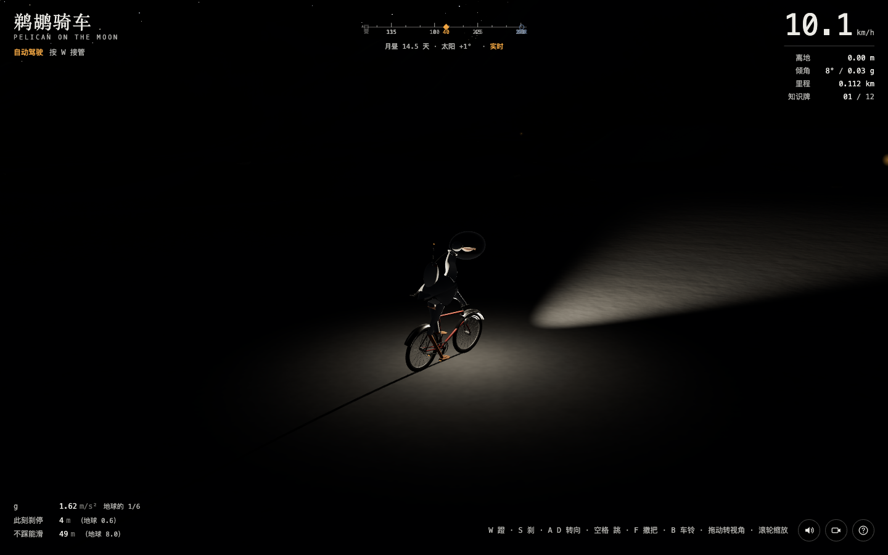
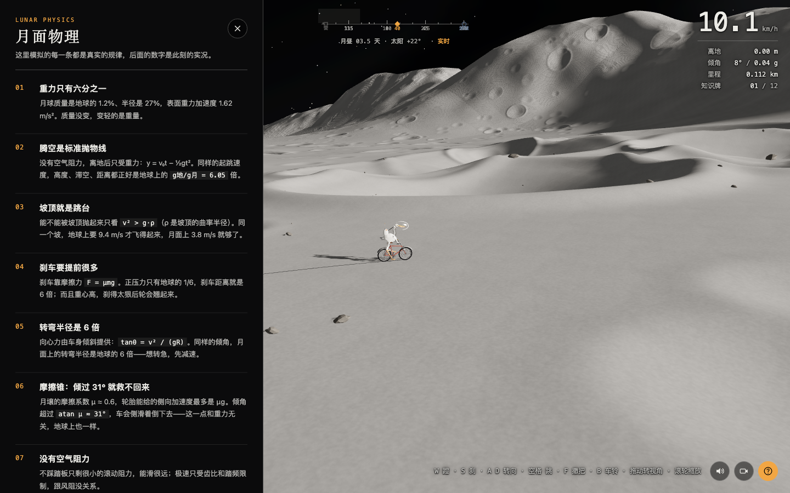
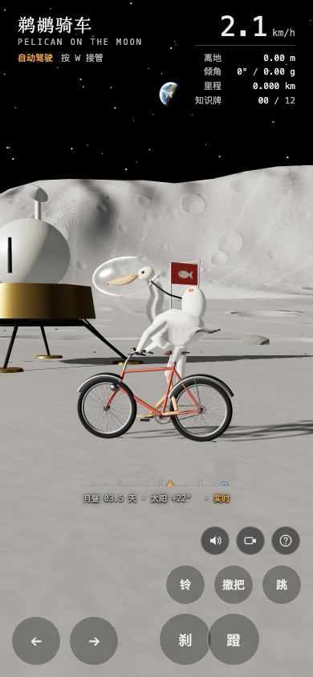

# 鹈鹕骑车 · 月面 | PELICAN ON THE MOON

一只戴玻璃头盔的白鹈鹕宇航员，骑着红色自行车在月面上闲逛、找知识牌、冲下环形山。Three.js 实时 3D，**1.54 MB 单文件 `index.html`，零外部资源**，`file://` 双击即开。

这个案例的重点是「注意物理规律」：重力、真空、低太阳角下的一切都是按公式算出来的，而且每一条都能在画面里亲手验证 —— 起跳滞空 2.3 秒、刹车要滑 12 米、撒把后慢慢倒下去。



## 玩法

- **不用操作也能看**：鹈鹕自动驾驶，按路线去找散布在月面的 **12 块知识牌**，找到会庆祝一跳；骑过之处留下不会消失的车辙。
- **随时接管**：`W / S` 蹬 / 刹，`A / D` 转向（方向键同）；`空格` 起跳；`F` 撒把；`B` 车铃。8 秒不操作交还给鹈鹕。
- **镜头**：`1`–`6` 六个机位（环绕 / 追尾 / 侧面 / 前方 / 远景 / 地球），`C` 循环，`E` 直达地球机位；拖动环绕、滚轮缩放。
- **时间**：`T` 切换「实时 / 1 秒 = 1 小时 / 1 秒 = 1 天」，约 30 秒过完一个昼夜 —— 影子慢慢转、太阳落下去、夜里只剩地球照和车灯。`K` 慢动作 0.3×。
- **其它**：`H` 打开物理面板（18 条规则，数值跟着当前车速实时算）；`M` 静音；`R` 回营地；`Esc` 收起卡片。
- **手机**：屏幕下方两角是触屏按钮（← → / 铃 / 撒把 / 跳 / 刹 / 蹬），画布上单指拖动环绕、双指捏合缩放。
- 已发现的知识牌、纪录、里程存在 localStorage，刷新不丢（`?reset=1` 清档）。

## 画面里能验证的物理

| 现象 | 公式 | 月面 | 地球 |
| --- | --- | --- | --- |
| 重力加速度 | g | 1.62 m/s² | 9.81 m/s²（比值 6.05） |
| 同样一跳（起跳 1.9 m/s） | h = v²/2g，t = 2v/g | 1.11 m / 2.34 s | 0.18 m / 0.39 s |
| 18 km/h 刹停距离 | v² / (2(μg + C·g)) | 11.9 m | 2.0 m |
| 18 km/h 不蹬能滑 | v² / (2·C·g) | 154 m / 62 s | 25 m |
| 18 km/h、倾角 19° 的转弯半径 | v² / (g·tanφ) | 45 m | 7.4 m |
| 建立倾角的时间常数 | √(L/g) | 0.81 s | 0.33 s |
| 撒把从 2° 倒到 23° | 倒立摆 | 2.50 s | 1.01 s |
| 坡顶把你抛起来的临界曲率半径 | v²/g | 15.4 m | 2.6 m |
| 后轮抓地上限 | μN / (1 − μh/l) | 60 N（腿力 90 N，起步会空转） | 361 N |
| 眼高 1.7 m 看到的地平线 | √(2Rh) | 2.43 km | 4.7 km |
| 车铃 | 真空不传声 | 0 dB | — |

物理里还有几条不那么直观、但月面上真实存在的：腾空时角动量守恒，空中既改不了倾角也改不了航向；侧向加速度被摩擦锥（atan μ ≈ 31°）封顶，所以再用力也倾不过去；刹车先抱死还是先前翻，取决于 μg 与 g·x/h 谁小。

## 技术要点

- **Three.js r170 本地化**：`vendor/three.module.js` 去掉 ESM 导出后包成 IIFE 命名空间，`build.py` 把 CSS + 8 个模块内联进 `shell.html`，产出单文件 `index.html`。
- **月面物理（`sim.js`，纯逻辑）**：固定步长 120 Hz。驱动 `min(P/v, F_leg)` 再被后轮抓地封顶；滚动阻力、坡度重力、刹车（牵引 vs 前翻取小）；转向由离心力与摩擦锥决定；平衡是「往倒的方向打车把」的倒立摆 PD 控制 + 前馈，增益随速度调度；腾空 = 自由落体，落地按重心判定；月尘走解析抛物线；静态摩擦让车真的停得住。自动驾驶靠候选航向规划（坡度 / 坑 / 曲率 / 石块代价）+ 近距离直接逼近。
- **地形（`terrain.js`）**：1024 m 周期瓦片、2048² 高度图（0.5 m 格），值噪声 + 山脊 + 带溅射裙的环形山剖面；物理用 Catmull-Rom 插值（C¹，坡顶起飞判定才不会抖），渲染用同一份数据的逐级 mip。
- **地形渲染（`world.js`）**：以鹈鹕为中心的 10 圈嵌套 LOD 方环，外缘 8 km，带月面曲率（d²/2R，所以地平线更近）；交界处零缝隙（外圈顶点取邻居 LOD + T 形顶点在粗边上线性插值 + 几何渐变）。高度图用**单通道 32 位浮点纹理** —— half 精度在几百米量级只能分辨 0.125 m，硬件双线性过滤会把曲面采成台阶。地形自阴影 = 沿太阳方向对高度场步进求交（宽度随距离放宽），车 / 石头 / 着陆器用阴影贴图（按 N·L 做坡度缩放偏移，否则低太阳角下满屏自遮挡条纹）。
- **天空与光照**：站点纬度 57°N，太阳 29.53 个地球日走一圈，默认是日出后第 3.5 天、高度 22°（全天都是长影子）；地球角直径 1.90°，圆缺由同一枚太阳算出（默认 62%）；星空不闪烁，银河是沿带分布的 1.6 万颗暗星；没有大气所以没有雾、没有光晕，影子里只剩「月面反光」和极弱的地球照。
- **角色（`model.js`）**：鹈鹕和自行车全部程序化建模 —— 车架 / 辐条 / 104 节链条实例 / 转向组件；鹈鹕是参数曲面 + 变半径管（身体、S 形脖子、长喙、喉囊、收拢的翅膀），两段 IK 把脚钉在踏板、翅尖钉在车把，喉囊是受 proper 加速度驱动的弹簧（失重时会飘起来），玻璃头盔是菲涅尔高光边。
- **坐标**：车以起点为中心折进 [−512, 512) m，跨边界时整个世界平移一个周期（相机、车辙、月尘同步），浮点精度不随里程变差；知识牌 / 营地 / 石头按「离车最近的周期像」摆放。
- **音频（`audio.js`）**：全部 WebAudio 合成。真空里没有风声，听到的只有呼吸、电台底噪、轮胎和链条通过车架传来的振动；腾空时轮胎噪音消失。
- **HUD**：任务遥测风（纯文字 + 细线 + 单一琥珀色），字幕在合适的时机把物理讲出来（起步空转、落地数据与地球对比、撒把、倒车……）。

## 开发

```bash
cd pelican-bike-3d
python3 build.py                        # 重新生成单文件 index.html
node test/run.mjs                       # 物理 / 地形 / 天空 / 自动驾驶逻辑回归
ego-browser nodejs < test/ui-regress.js # 浏览器 UI 回归（ego-lite，单 TaskSpace，复用 p1）
open index.html
```

目录：`src/`（terrain · sim · audio · model · world · ui · game · main）、`vendor/`（three r170 + MIT 许可）、`test/`（逻辑回归 + UI 回归）、`shots/`（验收截图）。

URL 参数：`?reset=1` 清档、`?seed=N` 换地形、`?time=0.5` 指定月昼相位、`?cam=earth` 初始机位、`?q=low` 低配（地形每环 16 格、像素比 1）、`?muted=1` 静音。测试钩子 `window.__pm`（`snapshot / bike / key / tick / step / teleport / plaques / setPreset / setTime / debug / errs / glErrors`）。

## 测试情况

- **逻辑回归** `node test/run.mjs`：**157 项断言全绿** —— 常数与闭式解、天空模型（太阳高度 / 地球圆缺 / 温度）、抛体、滑行、刹车、驱动、转向与反打、平衡与撒把、摩擦锥、腾空角动量守恒、坡顶起飞（月面 3 m/s 不飞、5 m/s 飞；地球 5 m/s 不飞）、坡道、月尘、车辙、知识牌发现、确定性、8 次自动驾驶巡游、10 分钟乱按、地形周期性 / 坡度 / 插值 / 环形山剖面 / 石块。
- **UI 回归** `test/ui-regress.js`（ego-lite，`file://`，真实 CDP 键盘 / 鼠标 / 触摸事件）：**51 项全绿** —— 桌面 30 项（接管、起步空转字幕、加速 / 滑行 / 转向 / 刹车、起跳滞空 2–2.6 s、撒把、车铃、六个机位与镜头按钮、时间流速、慢动作、静音、物理面板、发现知识牌 → 卡片 → Esc、回营地不清进度、刷新后存档恢复、手动骑过瓦片边界、8 秒交还、拖动 / 滚轮）；移动端 17 项（竖屏 390×844 / 横屏 844×390 布局无重叠、7 个触屏按钮 ≥ 44 pt、触摸蹬 / 刹 / 跳 / 撒把 / 铃 / 双指同按、单指拖动与双指捏合、HUD 按钮）；性能与浸泡 4 项（视网膜像素比 2 每帧耗时、`?q=low`、自动驾驶 60 s）。全程 `__errs` 为空、`gl.getError()` 为 0，启动与整个昼夜循环期间控制台零输出。
- **自动驾驶**：默认地形上 8 次巡游全部找齐 12 块知识牌，每趟约 640 s / 2.3 km，摔倒不超过 1 次。
- **性能**（M 系列 Mac，1440×900）：约 20 万三角面 / 123 个 draw call，像素比 1 每帧 3.3 ms，像素比 2（2880×1800）每帧 7.9 ms；`?q=low` 约 11 万三角面。连续掉帧会自动降像素比。
- **在线链接**：<https://case.youyongai.com/pelican-bike-3d/>（推送 main 后由 GitHub Actions 发布）。本地 `index.html` 双击即开，无需服务器。

## 截图

| | |
| --- | --- |
|  |  |
|  |  |
|  |  |
|  |  |
