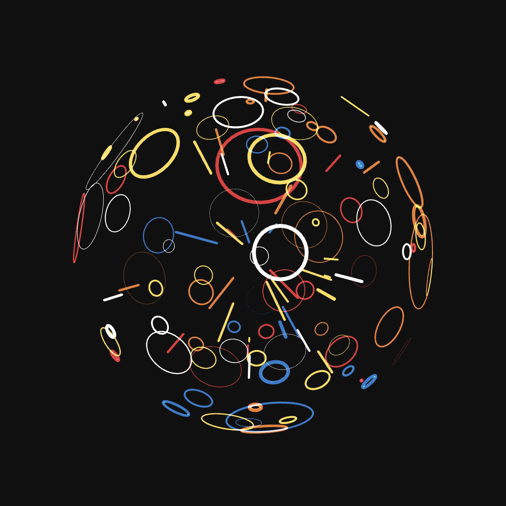

# 球面涟漪 · Sphere Ripples

一个看不见的球悬在暗场里，球面上不断有涟漪冒出来：**一截光线从球心射出**，飞抵球面时**炸开一圈贴着球面的光环**，光环胀大、变淡、消散，然后换一个方向重生。单文件 HTML，p5.js 1.9.4 WEBGL 模式，1080×1080，60fps。



## 玩法 / 画面

- **看不见的球**：半径 = 画布短边 × 0.32 = 345.6，球体本身一个像素都不画，只画从它表面荡开的涟漪。
- **同时 150 个涟漪**，每个涟漪持有一个球面上均匀分布的随机方向。
- **三段生命周期**（每段各自独立计时）：
  1. **射线段（0.5s）**——一条线从球心沿该方向射向球面。头部进度 `√p`、尾部进度 `p`（p: 0→1），所以光段是"甩出去"的：头冲得比尾快，尾巴最后才追上头、一起消失在球面上。
  2. **涟漪段（随机 1~2s）**——射线落点荡开一个贴着球面的圆环。张角从 0 扩到 `0.05~0.25` 弧度之间的随机值，按 `1-(1-t)^2.2` 缓出（先快后慢）；线宽从 5px 按 `t²` 细到 0，然后整个涟漪消失。
  3. **重生**——立刻换一个新随机方向，延迟 0~0.5s 后重新开始；开场时 150 个涟漪的延迟在 0~4s 内错开，所以画面是"逐渐被点亮"而不是齐刷刷炸开。
- **配色只用 5 种**，每个涟漪随机一种：蓝 `#146cbd`、白 `#f3f3f3`、橙 `#df6c1f`、红 `#d72329`、黄 `#ffcc3f`。
- **加色发光**：`blendMode(ADD)` 叠加，前景与背景元素同时可见，像线框一样互不遮挡。
- **镜头**：整体绕 Y 轴持续转动（0.2 rad/s），同时绕 X 轴缓慢点头 `rotateX(-0.25 + sin(t·0.2)·0.5)`。
- **圆环**：36 段顶点闭合、`noFill`。
- **时间**：一律 `frameCount / 60`，不使用 `millis()`，方便逐帧录制与复现。

## 技术要点

- 单文件 `index.html`，p5.js 走 CDN（`p5@1.9.4`），**首屏需要联网**，之后可离线打开。
- 球面均匀随机方向：`y = 2u-1`（u 均匀），方位角均匀，`√(1-y²)` 配平，保证面积均匀而非经纬均匀。
- 圆环几何：以方向 `d` 为中心，在切平面基 `(u, v)` 上取 36 个点，圆心角 `a` 的球面小圆顶点为
  `p(θ) = (d·cos a + (u·cos θ + v·sin θ)·sin a) · R` —— 每个顶点都精确落在半径 R 的球面上（单元测试逐点校验 |p| = R）。
- **关闭深度测试**：WEBGL 默认开深度缓冲，近处元素会挡住远处元素。脚本每帧在 `blendMode(ADD)` 之后调用 `gl.disable(gl.DEPTH_TEST)`，让前后元素全部叠加可见（UI 回归实测 `isEnabled(DEPTH_TEST) === false`）。
- 每帧 `background(#101010)` 清屏重画，`frameRate(60)`。
- 画布逻辑尺寸严格 1080×1080（`createCanvas(1080, 1080, WEBGL)`），绘制缓冲区随设备像素比放大（Retina 上为 2160×2160），保证 1080 逻辑像素构图在高分屏上依然锐利。

## 测试情况

| 层 | 方式 | 结果 |
|---|---|---|
| 逻辑层 | `node test/run.mjs` —— 把内联脚本抽进 `node:vm`，用桩替代 p5 绘图 API，逐帧驱动 1200 帧，断言几何与生命周期 | **17/17 全绿** |
| UI 层 | `ego-browser nodejs < test/ui-check.mjs` —— 真实 Chromium 1080×1080 视口，`readPixels` 读回帧缓冲 | **13/13 全绿**，实测 **60.33fps**，全程零 JS 异常 / 控制台 error |

逻辑层覆盖：涟漪数量、开场延迟区间、方向单位长、切向基正交且正交归一、张角上限、涟漪时长、调色板约束、每帧清屏与 ADD 切换、镜头角度公式、生命周期帧数（射线 30 帧 / 涟漪 60~120 帧 / 重生延迟 ≤30 帧）、射线头 `√p` 尾 `p` 且不越球面、圆环 36 顶点闭合且贴球面、缓出单调且 `e(t) ≥ t`、线宽按 `t²` 收到 0、时间基准不含 `millis`。

UI 层覆盖：WEBGL 渲染器、p5 1.9.4、画布 1080×1080、150 个涟漪、深度测试关闭、ADD 混合（目的因子 = ONE）、发光像素数、5 种配色在画面上全部出现、三种生命周期状态并行、方向单位长、帧率 ≥55fps、画面逐帧演进、无异常事件。

## 在线链接

待部署。发布后为 <https://case.youyongai.com/sphere-ripples/>；本地直接双击 `index.html` 即可运行。

## 目录

```
sphere-ripples/
├── index.html        # 单文件本体（p5 CDN + 全部逻辑）
├── test/
│   ├── run.mjs       # node 逻辑层回归（17 项）
│   └── ui-check.mjs  # ego-browser UI 层回归（13 项）
└── README.md
```
