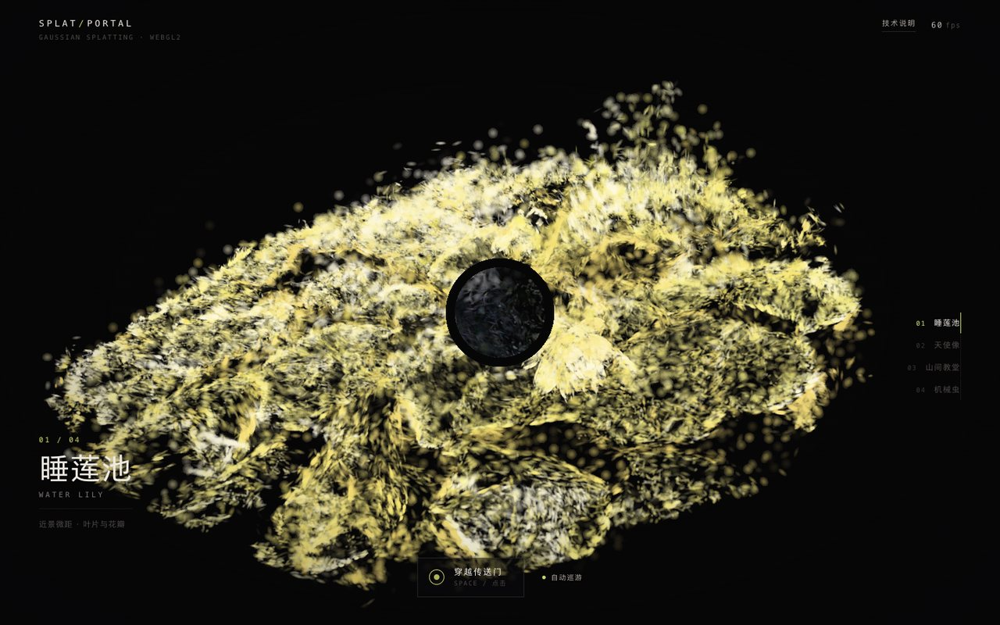
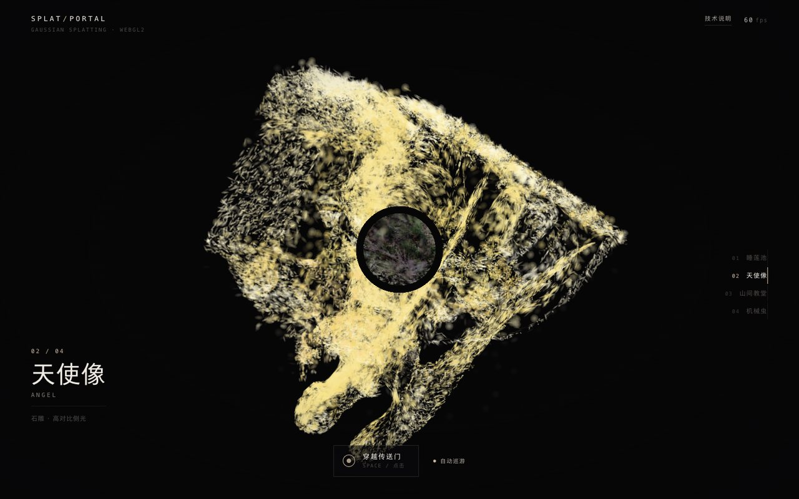
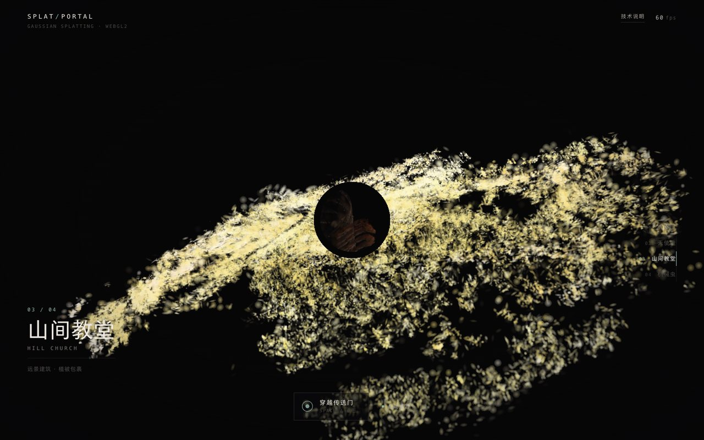
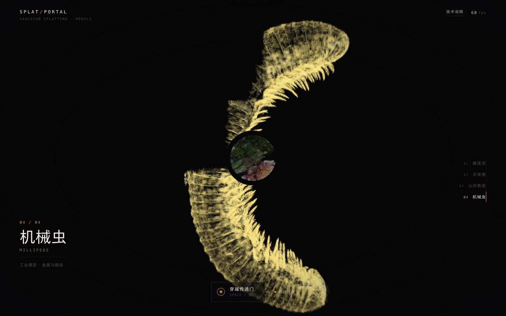

# 传送门 · 高斯泼溅 · SPLAT PORTAL

四个真实扫描场景串成一条环，浏览器里实时渲染几十万颗三维高斯球；走近门洞，穿过去就是下一个世界。

**[在线体验](https://case.youyongai.com/splat-portal/)**

---

## 玩法

- 拖拽旋转，滚轮 / 双指缩放
- 空格、回车，或点「穿越传送门」：门洞张开 → 世界切换 → 新世界从径向弹开落位
- 右侧（手机在底部）编号可直接跳到任意世界
- 「自动巡游」让镜头缓慢绕场

## 四个世界

| # | 场景 | 内容 | 点数 |
|---|------|------|------|
| 01 | 睡莲池 WATER LILY | 近景微距，叶片与花瓣 | 260,000 |
| 02 | 天使像 ANGEL | 石雕，高对比侧光 | 260,000 |
| 03 | 山间教堂 HILL CHURCH | 远景建筑，植被包裹 | 260,000 |
| 04 | 机械虫 MILLIPEDE | 工业模型，金属与锈迹 | 116,352 |

| | | |
|---|---|---|
|  |  | |
|  |  | |

## 技术要点

**这不是视频，是点云。** 画面里每一粒都是一颗三维高斯球：自带位置、朝向、三轴尺度、颜色和不透明度，几十万颗叠加才拼出看起来像照片的空间。

### 1. 数据压缩（`tools/bake.py`）

原始 `.splat` 每点 32 字节（位置 f32×3、缩放 f32×3、RGBA8、四元数 u8×4）。烘焙成 20 字节/点：

| 字段 | 原始 | 压缩后 |
|------|------|--------|
| 位置 | 12 B (f32×3) | 6 B (int16×3，按轴定标) |
| 缩放 | 12 B (f32×3) | 6 B (log 量化到 uint16) |
| 四元数 | 4 B | 4 B (int8×4，运行时归一化) |
| 颜色 | 4 B | 4 B |

同时以「80 分位半径」把每个世界归一化到统一尺度，并把机位一起算好写进 `manifest.json`——所以四个世界共用同一套相机与传送门参数。

### 2. 渲染（`src/renderer-gl.js`）

实例化渲染：每个高斯一个 6 顶点四边形（`gl_VertexID` 生成），顶点着色器把 3D 协方差用 EWA 投影成屏幕椭圆，片元做高斯衰减，前向 alpha 混合。

每帧计数排序（2048 个视深桶）后重排属性缓冲，保证由远到近绘制；相机位移小于阈值时跳过重排。

### 3. 传送门

门洞是世界空间里的一块圆盘。每个像素用「视线 × 门盘」求交：

- 落在门外 → 画当前世界
- 落在门内 → 画下一个世界

同一套数据渲染两遍，接缝天然对齐，不需要模板缓冲或离屏纹理。

### 4. 跨端

- 默认 WebGL2（跨端最稳）；`?backend=gpu` 可切到 WebGPU 实验路径（同一套数据与着色逻辑，带宽更省）
- 手机自动降低可见点数（4.5 万 vs 桌面 9 万）与分辨率
- 自适应画质：帧率掉下来先减点数、再降 DPR，回升后逐步恢复
- 触摸：单指旋转、双指缩放、点按穿越

### 5. 调参入口

`?cap=` 单点最大屏幕尺寸（px）、`?n=` 可见点数、`?alpha=` 不透明度、`?backend=gl|gpu` 强制后端。

## 测试

```sh
# 起一个静态服务
python3 -m http.server 8899

# 需要先有一个开着 CDP 的 Chromium（ego lite 或 Chrome）
node test/run.mjs
```

覆盖桌面 1440×900 与手机 390×844 两种视口：加载完成、四世界载入、rail 切换与 HUD 同步、传送门开合与穿越、帧率下限、无滚动溢出、无 JS 报错。截图输出到 `/tmp/splat-portal-shots`。

## 数据来源与许可

- 场景：[Nehc/splats](https://huggingface.co/datasets/Nehc/splats)（MIT）—— 睡莲池、天使像、山间教堂
- 场景：[three.js](https://github.com/mrdoob/three.js) `examples/models/splat/millipede.splat`（MIT）—— 机械虫
- 渲染器、传送门、压缩格式与页面为本案例原创实现

## 目录

```
splat-portal/
├── index.html          构建产物（单文件 UI + 渲染器）
├── build.py            内联 src/* → index.html
├── cover.jpg
├── assets/             烘焙后的 .bin 与 manifest.json
├── src/
│   ├── format.js       二进制解析（20 字节交错记录）
│   ├── renderer-gl.js  WebGL2 渲染器 + 传送门遮罩
│   ├── renderer-gpu.js WebGPU 实验路径
│   ├── main.js         世界管理、相机、传送门状态机、输入
│   ├── shell.html      页面骨架
│   └── style.css       暗室观察台风格
├── tools/bake.py       .splat → 紧凑格式 + 自动选机位
└── test/run.mjs        CDP 回归脚本
```
