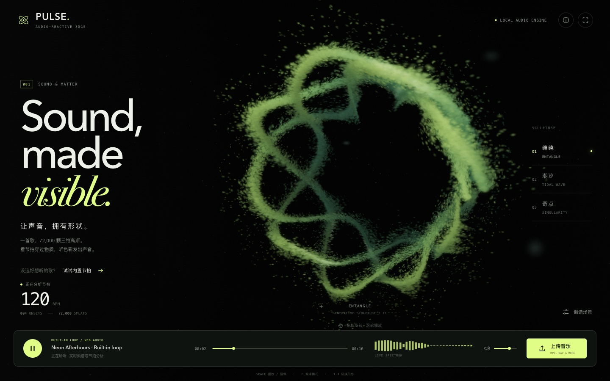

# PULSE · 让声音拥有形状

音乐驱动的实时 **3D Gaussian Splatting** 声音雕塑。上传一首歌，低频让点云呼吸，中频形成波纹，高频点亮细节；也可以直接播放内置电子节拍。

**[在线体验](https://case.youyongai.com/splat-pulse/)** · 本地直接打开 `index.html` 也可以运行。



## 玩法

- **上传音乐**：点击「上传音乐」或把音频文件拖进页面。支持浏览器可解码的 MP3、WAV、M4A、AAC、OGG、FLAC 等格式，具体编码支持以浏览器为准。
- **没有曲目**：点击「试试内置节拍」或播放键，听一段 16 秒、120 BPM 的 WebAudio 合成循环。
- **三种形态**：缠绕 ENTANGLE / 潮汐 TIDAL WAVE / 奇点 SINGULARITY，同一组高斯连续 morph。
- **演出控制**：播放/暂停、拖动进度、音量/静音、实时频谱、onset 计数与 BPM 估算。
- **场景调谐**：反应强度、高斯尺寸、自动环绕、酸橙/冰川/落日三套配色。
- **相机**：拖拽旋转、滚轮缩放；手机单指旋转、双指捏合；双击或 R 重置。
- **纯净模式**：H 隐藏全部界面，保留可交互三维场景；F 请求浏览器全屏。

快捷键：Space 播放/暂停，1/2/3 切换形态，R 重置视角，F 全屏，H 纯净模式，Esc 关闭面板/退出纯净模式。

## 技术要点

### 真正的三维高斯，不是视频或普通圆点

固定种子程序化生成 **72,000 颗高斯**。每颗都有三维位置、三轴尺度、表面方向、颜色参数、频带映射与透明度。三份位置纹理对应三种雕塑形态，背景尘埃不参与音频变形。

WebGL2 渲染路径：

1. 以 1024 桶视深计数排序组织高斯，顺序写入 R32F 纹理，由远到近前向 alpha 混合。
2. 每颗高斯使用 4 顶点实例化三角形带；顶点着色器把三维协方差经 EWA 近似投影为屏幕椭圆。
3. 片元执行高斯衰减与柔边裁切，结合视角高光、前后明暗和远景衰减。
4. 离屏场景经过轻量辉光、色调压缩、暗角和微量颗粒合成。

### 音乐真的驱动画面的参数

内置循环与用户文件统一走 `AudioBufferSourceNode → AnalyserNode → GainNode → destination`。音频只在本地解码，不上传服务器。

- 2048 点 FFT，计算 bass / mid / high / level 与 32 条对数频带。
- 20–160 Hz 低频能量变化和频通量检测 onset，使用自适应历史阈值与约 0.2 秒 refractory。
- 至少三个稳定节拍间隔后才估算 BPM，范围 70–180；暂停或节拍不稳定时显示 `--`，不拿固定数值冒充分析。
- 低频控制径向冲击与呼吸，中频控制行进波纹，高频控制细节位移、光点尺度与亮度。
- 内置音轨由手工双声道 PCM 合成，包含 kick、snare、hats、sub bass、arp 和 pad，无音频文件请求。
- 音频分析使用独立 30 Hz 调度，形态转场和相机按真实经过时间推进；低渲染帧率时也不会把动画拖成逐帧慢放。

### 跨端与性能

- 桌面默认提交 72,000 颗，手机竖横屏与矮屏 42,000 颗；帧率不足时减少点数和渲染 DPR，小横屏 DPR 上限 1.35。
- 手机竖屏重排标题、形态栏与播放控制台；横屏使用独立紧凑布局、显式播放台列位置、可滚动调谐面板与刘海安全区。
- 「奇点」自动使用更远的默认镜头，手动缩放后尊重用户距离；上传按钮在竖屏和两种横屏下均保留完整触控宽度。
- 页面隐藏时停止音频分析计时器和渲染提交；支持 WebGL 上下文恢复提示与 `prefers-reduced-motion`。
- `index.html` 约 106 KB，无三方库、CDN、外部字体、模型或音频资源。`cover.jpg` 仅用于案例索引和社交分享。
- 在 Apple M1 Max 测试环境的 Chromium 中，桌面与 390×844 手机仿真实测约 110–120 FPS；实际性能随设备、浏览器和场景而变，不代表所有设备的保证值。

## 本地运行与构建

直接双击 `index.html` 即可。也可以在项目根目录启动静态服务：

```sh
python3 -m http.server 8907
# 打开 http://127.0.0.1:8907/splat-pulse/
```

修改 `src/*` 后重新构建：

```sh
python3 splat-pulse/build.py
```

## 测试

```sh
node --test splat-pulse/test/audio.test.mjs
node splat-pulse/test/geometry.test.mjs

# 先启动上面的 8907 静态服务，再用 ego-lite 运行真实浏览器回归
# 将路径替换为本机 test/run.mjs 的绝对 file:// URL
ego-browser nodejs -e "await import('file:///绝对路径/ai-cases/splat-pulse/test/run.mjs')"
```

- **14 项音频逻辑回归**：频带映射、静音/暂停、持续低频、噪声、阈值与 refractory、稳定/不规则 onset、BPM 估算与折叠、PCM 双声道/峰值/循环边界、未初始化行为。
- **5 项几何回归**：固定种子、三种形态、真实三维纵深、尘埃稳定性、尺度与相机矩阵。
- **70 项 ego-lite 浏览器回归全部通过**：1440×900 桌面、390×844 手机、360×640 小屏、844×390 与 568×320 横屏；真实文件选择、WAV 解码播放、120 BPM 测试鼓点、暂停/seek/真实增益、自然结束、三形态、参数、相机、触摸、全屏、纯净模式、非法文件保留旧轨、拖放、真实画布像素、横屏按钮宽度、面板边界与无 JS/WebGL 错误。
- **补充实测**：1512×819 矮屏排版、`file://` 直接打开、减少动态偏好、零外部资源请求，以及 Kimi Code Desktop 内置浏览器视觉复核。
- 测试检查点状态输出到 `/tmp/splat-pulse-shots/checkpoints.json`，关键视口的完整窗口截图由 KimiCU 或内置浏览器复核，避免离屏 Chrome 的同步截图接口阻塞回归。封面来自真实播放画面；16 秒测试 WAV 可用 `python3 splat-pulse/test/make-fixture.py` 重新生成。

本轮未对 Safari、Firefox 或手机真机做实测。需要支持 WebGL2 与 Web Audio；浏览器全屏和音频编码支持以当前浏览器为准。

## 目录

```text
splat-pulse/
├── index.html          构建产物，单文件直接打开
├── build.py            src/* → index.html
├── cover.jpg           真实播放截图
├── src/
│   ├── shell.html      页面与控制台
│   ├── style.css       桌面/手机/矮屏/纯净模式样式
│   ├── geometry.js     三种高斯几何与相机矩阵
│   ├── audio.js        音频引擎、onset/BPM、内置 PCM 音轨
│   ├── renderer.js     WebGL2 高斯投影、排序、辉光合成
│   └── main.js         交互、音频映射、渲染循环与自适应画质
└── test/
    ├── audio.test.mjs
    ├── geometry.test.mjs
    ├── run.mjs         ego-lite 桌面/手机端到端回归
    ├── make-fixture.py
    └── fixtures/       带明确鼓点的本地测试 WAV
```
