# 超临界 · SUPERCRITICAL

> k < 1，火会熄。k = 1，刚好自持。k > 1，没有人能叫停。
>
> 一份关于**智能爆炸**的 14 幕交互演示文稿。它从一个人类的句子开始，以把那个句子还给人类结束。

**在线体验**（推送到 `main` 后由仓库的 GitHub Actions 自动部署）：<https://case.youyongai.com/supercritical/>  
**离线运行**：直接双击打开单文件 [`index.html`](./index.html)（约 1.69 MB，零外部网络资源，`file://` 可直接放映，需要支持 WebGL 2 的现代浏览器）

---

## 它讲什么

论点只有一个：**让 AI 变强的那份工作，正在被 AI 自己接过去；一旦接过去，速度就不再由人决定。**

全片借核链式反应的框架展开。k 是「一次裂变平均点燃几次新的裂变」，在这里是「这一轮进步给下一轮进步带来多少推力」。三幕对应 k 的三个区间，配色是物理驱动的黑体辐射——冷灰（人类、已知）→ 炽红（机器、加速）→ 纸白（视界之外）。

开场是这套演示文稿自己的来历：屏幕上逐字打出人类的全部指示（134 个字，一字未改），然后并置机器的输出——14 幕、四千多行代码、一个文件。结尾把指示的最后四个字「祝你好运」还给人类。

**一个对论点不利的数字，被放在了正中间**：按 Epoch 的估算，前沿训练算力从 2025 年起明显放慢了。片子没有绕开它，而是用后面三幕证明：慢的是「堆芯片」，不是能力——价格、任务时长、AI 做 AI 研究，没有一条线慢下来。

---

## 14 幕

| 幕 | ID | 标题 | 转场 | 画面与论点 |
| --- | --- | --- | --- | --- |
| 01 | `brief` | 输入 | `fade` | 人类的全部指示逐字打出并缩小定格 → 标题「超临界」；右侧并置输出：行数、文件数、`1 : 32` |
| 02 | `fold` | 对折 42 次 | `plot` | 一张 0.1 毫米的纸，每折一次厚度翻倍。对数标尺上柱子**匀速**上升（坐标系在骗你），读数却从 105 米到卡门线再到 **439,805 公里** |
| 03 | `compute` | 二十亿倍 | `burn` | AlexNet → GPT-6 Astra 的前沿训练算力（Epoch 估算）；**对数坐标变形为线性坐标**，前面十一年贴着地；2025 年起的拐点与「按原斜率」的虚线 |
| 04 | `price` | 思想的价格 | `drop` | 价签坠落：GPT-4 级智能 $37.50 → $0.07（19 个月，536 倍）；一道博士题 30 美分 → 0.04 美分；对照条：AI 一年的跌幅，摩尔定律要 6 年、锂电池 18 年、电气化早期的电 54 年 |
| 05 | `horizon` | 时长 | `stretch` | METR 任务时长：4 分钟 → 17 小时，每 4.3 个月翻倍；虚线外推——一整天「已经到了」，一周 2027 年秋，一个月 2028 年中，一年 2029 年底；小倍数：三把尺子同一条线 |
| 06 | `lab` | 八个环节 | `ring` | 八段环逐段点亮：读文献、写代码、调实验、写内核、设计芯片、发现算法、做数学、做研究——每一段一个带日期的样本，环心是关键数字 |
| 07 | `critical` | 临界 k | `burn` | **可交互的链式反应模拟**。k < 1 会熄，k = 1 自持；把鼠标往右移，把 k 推过 1 |
| 08 | `good` | 1965 · 智能爆炸 | `rewind` | 图灵 1951、古德 1965、文奇 1993 的原话；AI Impacts 历年调查的预测日期一路左移；以及 1970 年明斯基的反例与回答 |
| 09 | `zeno` | 时间 | `zeno` | 代与代的间隔等比收束，在有限时间里堆进无限多代；一个算术：进步若每年翻倍，二十世纪的一百年从 100 年缩到 **13.4 小时** |
| 10 | `nation` | 天才国度 | `shockwave` | 延伸到地平线的灯海；「一个数据中心里的天才国度」；ChatGPT 周活 12 亿、四大云厂商年资本开支约 7,300 亿美元 |
| 11 | `science` | 快进的百年 | `halftone` | 12,500 格的结构网格：放大时人类的半个世纪是 12 个白格，镜头拉远，2 亿格被一年淹过 |
| 12 | `scale` | 瓦 | `zoom` | 26,000 个粒子的六级功率阶梯：人脑 20 W → 三峡 → 全球发电 → 行星阳光 → 戴森云 → 银河系 |
| 13 | `white` | 视界 | `overexpose` | 过曝转白。文奇那句话的后半句；过了某个点我们看不见了，但有三件事现在就能说；维纳，1960 |
| 14 | `luck` | 祝你好运 | `fade` | 三件能做的事；然后那四个字被打出来，还给人类 |

---

## 技术要点

- **引擎复用，创意层全新**：HDR 渲染管线、GPU 中文排版引擎与节拍驱动的运行器沿用 [`last-half-pixel`](../last-half-pixel/) 的自研底座（Three.js r170，WebGL 2，AgX 色调映射 + 6 级 Bloom + 动态分辨率缩放）。配色、排版、14 幕场景、12 种转场与整套声音都是为这部片子重做的。
- **`src/kit.js` — 设计系统与 2D 矢量引擎**：
  - 令牌化的舞台坐标（1920 × 1080）、配色（冷灰 / 黑体炽红 / 纸白）与字体预设（宋体黑 · Didot · 等宽）；
  - 任意粗细的**带状描边**（逐点斜接 + 尖角限幅，盒滤波解析抗锯齿），支持沿路径的「逐笔画出」、虚线与近场辉光；实例化圆点与矩形；
  - 统一的舞台空间 GLSL 预置（`stage()` / `pxUnit()` / SDF 基元），所有全屏着色器都按 1920 × 1080 舞台坐标作画，与文字坐标一一对齐。
- **12 种 GLSL 转场**（`src/transitions.js`），每种对应一个物理隐喻，且都是 p 的纯函数，可正向也可倒放：`plot` 绘图笔、`burn` 炽烧前沿、`drop` 自由落体、`stretch` 横向拉丝、`ring` 火环、`rewind` 胶片回卷、`zeno` 芝诺收束（每次减半到来得快一倍）、`shockwave` 冲击波、`zoom` 尺度空间溶解、`overexpose` 过曝、`halftone` 半调网点、`fade`。
- **数据即画面**：图表不是贴图。算力曲线、价格坠落、时长外推、基准小倍数、调查日期、功率阶梯全部由 `src/data.js` 的数值在运行时生成；对数 → 线性的坐标变形、趋势线拟合（2023 年后的最小二乘）都在运行时计算。
- **自研的模拟**：第 07 幕是一个真实的分支过程模拟（格点、中子飞行、燃烧与不应期），鼠标横坐标连续驱动 k。
- **程序化声音**（`src/beds.js`）：零音频文件。铺底以 C1 为基频、随 k 升温——第一幕空五度、临界处叠入三全音、第三幕管风琴与合唱、白场上只剩一根纯正弦；12 种转场各有配方（芝诺转场是 22 次加速的滴答，炽烧是低频轰鸣加纤维裂响）。
- **单文件零依赖构建**（`build.py`）：内联 Three.js 与全部源码，并在构建期写入体量信息，第 01 幕的「1 : 32」来自真实行数。

---

## 快捷键与交互

| 操作 | 功能 |
| --- | --- |
| `→` `↓` `空格` `Enter` / 左键点击 / 左滑 | 下一节拍或下一幕 |
| `←` `↑` `Backspace` / 右键 / 右滑 | 上一节拍或上一幕 |
| 第 07 幕，**移动鼠标** | 调节 k（横向），把火推过临界 |
| `N` | 内置中文演讲者备注 |
| `P` | 独立演讲者备注窗口 |
| `O` | 14 幕缩略图总览（点击跳转） |
| `F` | 全屏 |
| `A` | 自动播放 |
| `M` | 静音 / 恢复 |
| `.` 或 `B` | 黑屏 |
| `?` 或 `H` | 快捷键帮助 |
| `#场景-节拍` | URL 深链，例如 `#critical-4`、`#scale-5` |

全部 65 个节拍都配了可直接照读的中文演讲备注（含停顿与操作提示）。

---

## 预览

| 01 · 输入：标题与「1 : 32」 | 02 · 对折 42 次：月球到了 |
| :---: | :---: |
| 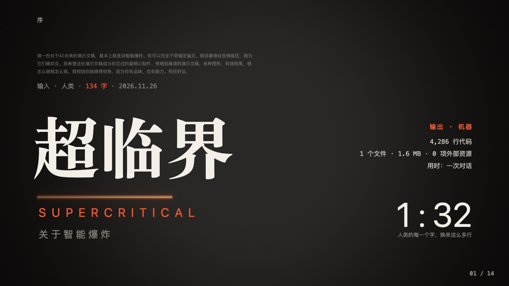 | 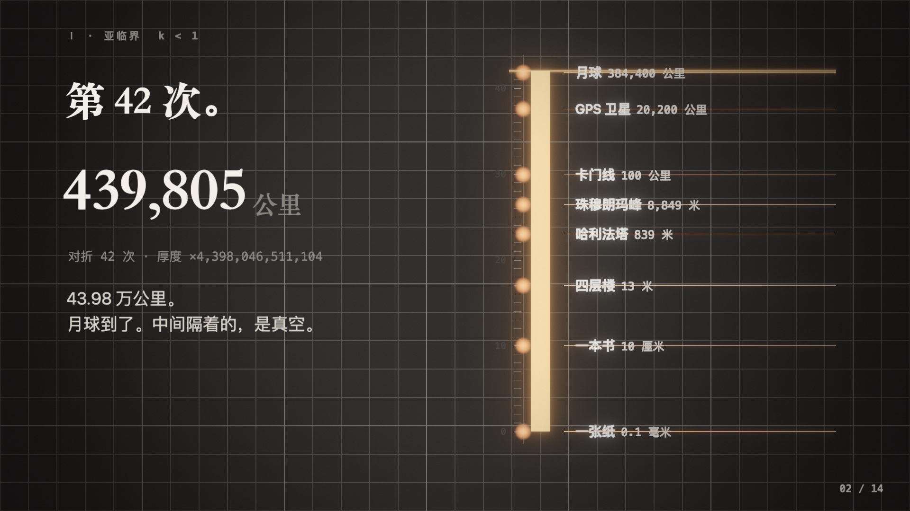 |

| 03 · 算力：换成线性坐标 | 03 · 算力：2025 年起的拐点 |
| :---: | :---: |
| 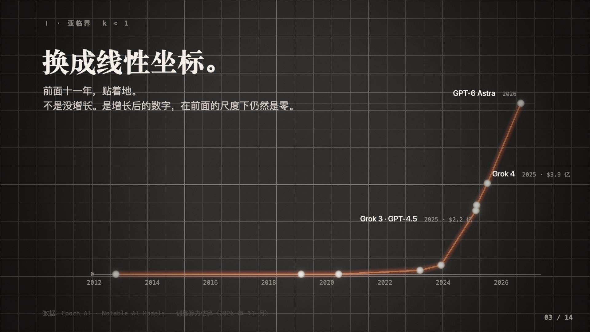 | 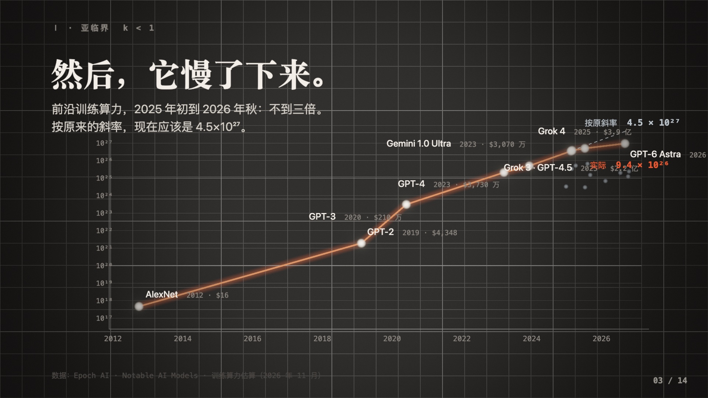 |

| 04 · 思想的价格 | 05 · 时长：照这条线走下去 |
| :---: | :---: |
| 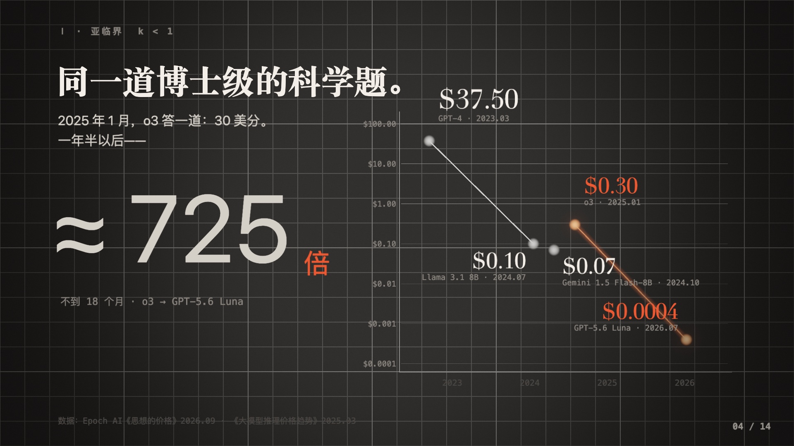 | 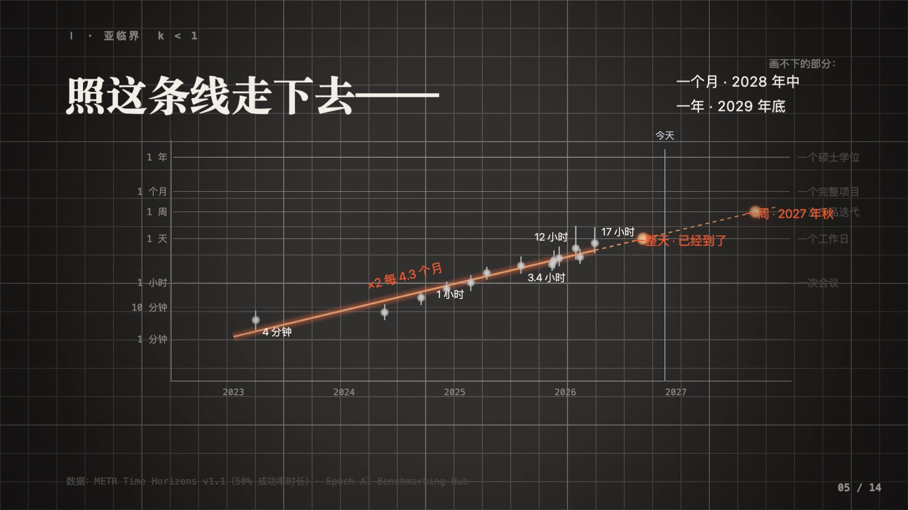 |

| 06 · 八个环节 | 07 · 临界 k：k > 1 |
| :---: | :---: |
| 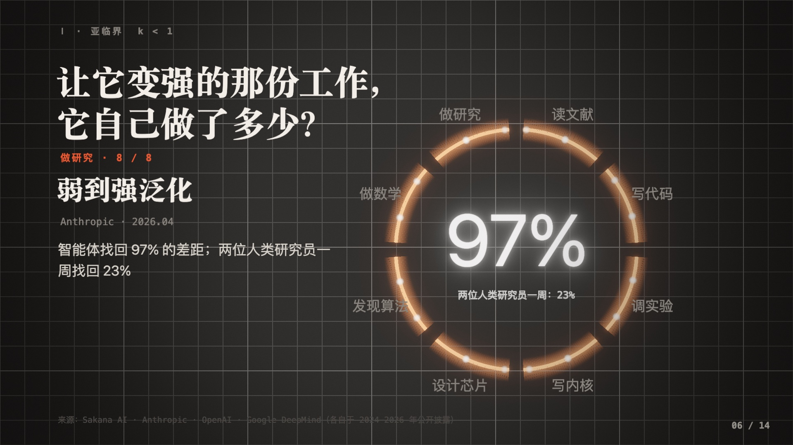 | 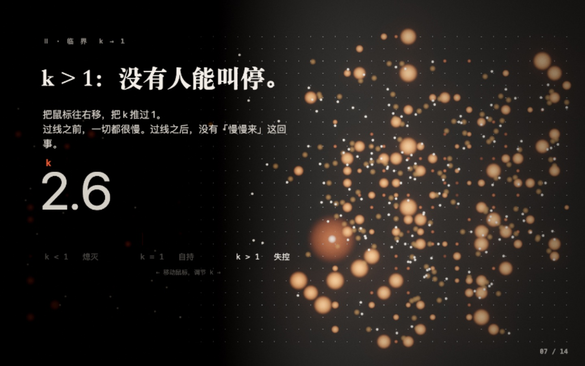 |

| 08 · 1965：古德的原话 | 09 · 时间：这个序列有一个终点 |
| :---: | :---: |
| 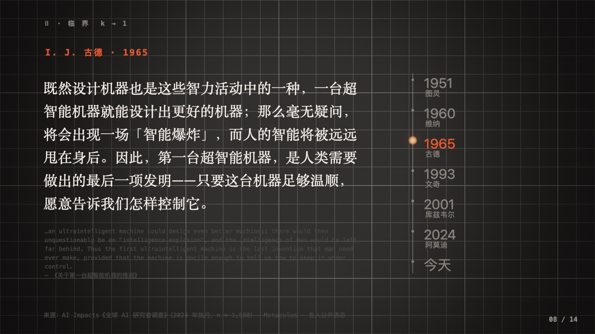 | 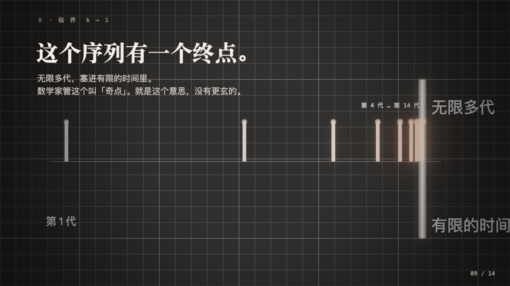 |

| 10 · 天才国度 | 11 · 快进的百年：一年，两亿个 |
| :---: | :---: |
|  | 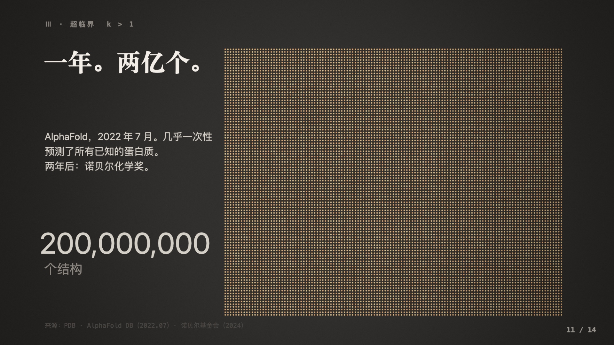 |

| 12 · 瓦：戴森云 | 12 · 瓦：整个银河系 |
| :---: | :---: |
| 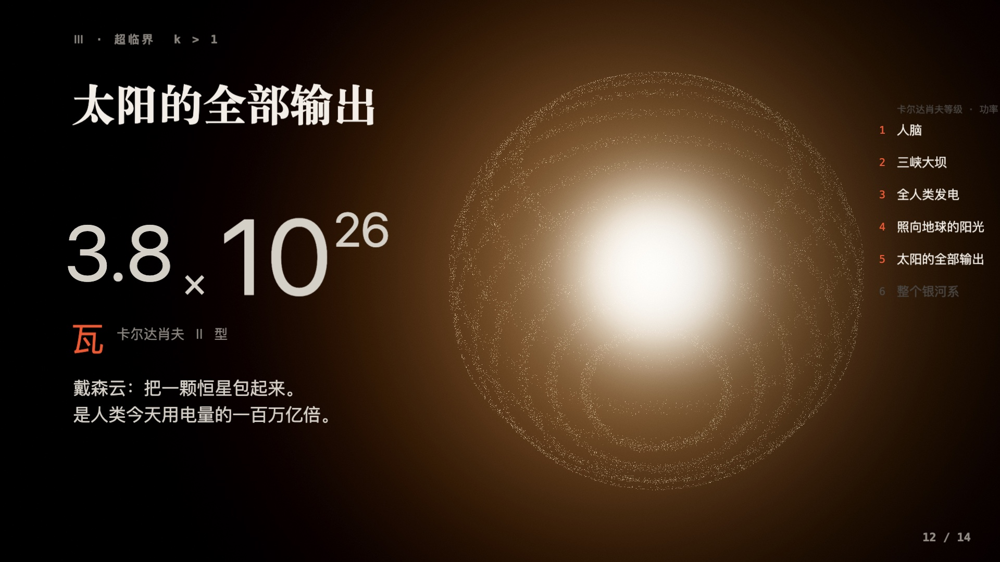 | 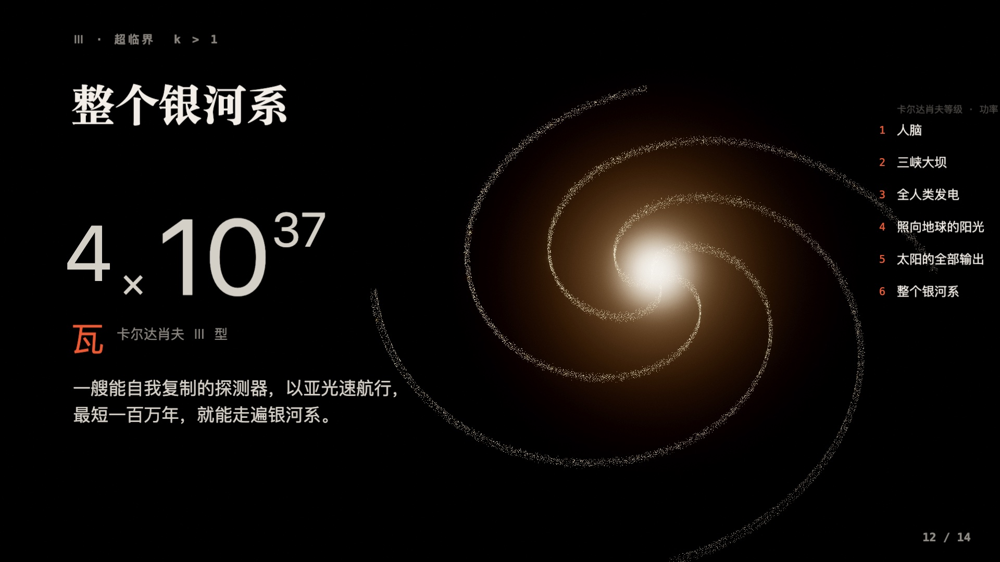 |

| 13 · 视界：过曝之后是纸白 | 14 · 把四个字还给人类 |
| :---: | :---: |
|  |  |

转场中点：[`burn`](./shots/t-burn.jpg) · [`ring`](./shots/t-ring.jpg) · [`zeno`](./shots/t-zeno.jpg) · [`stretch`](./shots/t-stretch.jpg) · [`rewind`](./shots/t-rewind.jpg) · [`overexpose`](./shots/t-overexpose.jpg)  
其余画面见 [`shots/`](./shots/)（含 14 幕总览与手机竖屏实拍）。

---

## 数据与口径

所有数字截至 **2026 年 11 月 26 日**，图表用的都是原始数值而非目测值。

- **训练算力**：Epoch AI《Notable AI Models》的训练算力估算（带置信分级；Gemini 2.x 之后与 Claude 各版本没有公开估算）。片中「拐点」一句只针对能查到的最大训练：2025 年初 3.8×10²⁶ → 2026 年秋 9.4×10²⁶ FLOP。
- **价格**：Epoch《The plunging price of thought》（2026.09）与《LLM inference price trends》（2025.03）。「比某技术快 N 倍」按对数降价速率之比理解，反推出的电力约 5%/年、算力约每 18 个月翻倍，与历史吻合。
- **任务时长**：METR Time Horizons v1.1（50% 成功率）。4.3 个月/翻倍是 2023 年以后各模型的最小二乘拟合，与 METR 自己的 4.2 个月一致；外推日期只是外推，演讲备注里给出了按全程 6.2 个月算的更晚日期。
- **AI 做 AI 研究**：Anthropic《When AI builds itself》、OpenAI、Google DeepMind、Sakana AI 各自的公开披露。
- **预测日期**：AI Impacts 2024 年执行的调查（n = 1,580）；Metaculus 社区中位数；各人的公开表态。
- **引文**：图灵 1951（BBC）、古德 1965、维纳 1960、文奇 1993、明斯基 1970、库兹韦尔 2001、阿莫迪 2024。英文为原文，中文为自译。
- **其余**：PDB 与 AlphaFold DB 的结构数、卡尔达肖夫的原始功率定义、联合国教科文组织的科研人员数。折纸与「一个世纪 → 13.4 小时」是纯算术，后者明确标注为条件推演。

---

## 测试回归情况

- **Node 逻辑 / 构建 / 数据 / 契约回归**（[`test/run.mjs`](./test/run.mjs)，`node supercritical/test/run.mjs`）：**23 / 23 全绿**
  - 全部源码 `node --check` 与 `build.py` 语法、单文件构建与零外部资源校验；
  - **数据一致性**：折纸能否到月球、算力比与翻倍次数、价格的各个倍数、时长拟合与外推、基准分数单调性、调查日期左移、结构网格是否恰好加总到两亿、功率阶梯、引文完整性；
  - 14 幕的顺序、节拍、转场与 65 条中文备注契约；音频铺底只引用真实存在的音色；12 条转场音效配方只引用真实存在的音效；着色器源码不使用 GLSL 保留字作标识符。
- **ego-browser UI 与 WebGL 2 视觉回归**（[`test/ui-verify.mjs`](./test/ui-verify.mjs)）：**19 / 19 全绿**，自最后一次修复起连续 8 次运行全绿
  - 离线 `file://` 冷启动，正常模式预热全部 14 幕并生成缩略图（约 5.7 秒），全程零运行时 / 控制台 / 着色器错误；
  - 全部 65 个节拍确定性 seek、25 张展示帧非空白且互相可区分、每幕 CPU 侧渲染开销上限；
  - 12 种转场各在 p = 0.2 / 0.5 / 0.8 共 39 个中间帧上验证；
  - 真实鼠标把 k 推过 1（画面显著变化且不误翻页）、点击翻页、全部演讲者快捷键、URL 深链；
  - 手机竖屏 390 × 844 与横屏 844 × 390。

复现：

```bash
node supercritical/test/run.mjs
ego-browser nodejs < supercritical/test/ui-verify.mjs
bash supercritical/test/shots-jpg.sh      # 把套件输出的 PNG 转成 README 用的 JPEG
```

`test/probe.mjs` + `test/plan.json` 是开发期的定点探针：按 `plan.json` 里的场景 / 节拍 / 时刻逐帧截图并汇总报错。

---

## 目录

```
supercritical/
├── index.html          # 构建产物：单文件，零外部资源
├── build.py            # 内联 Three.js 与 src/*，并写入体量信息
├── vendor/             # three.module.js (r170) 与许可证
├── src/
│   ├── template.html   # 页面骨架与演讲者界面的样式
│   ├── math.js gfx.js type.js audio.js deck.js   # 引擎（沿用并改造）
│   ├── kit.js          # 设计令牌 + 2D 矢量引擎 + 舞台空间 GLSL 预置
│   ├── data.js         # 全部事实数据与引文
│   ├── beds.js         # 场景铺底与转场音效配方
│   ├── transitions.js  # 12 种 GLSL 转场
│   ├── scenes-a.js     # 第 01–05 幕
│   ├── scenes-b.js     # 第 06–10 幕
│   └── scenes-c.js     # 第 11–14 幕
├── test/               # run.mjs · ui-verify.mjs · shots-jpg.sh · probe.mjs
└── shots/              # README 用的 JPEG 截图
```
