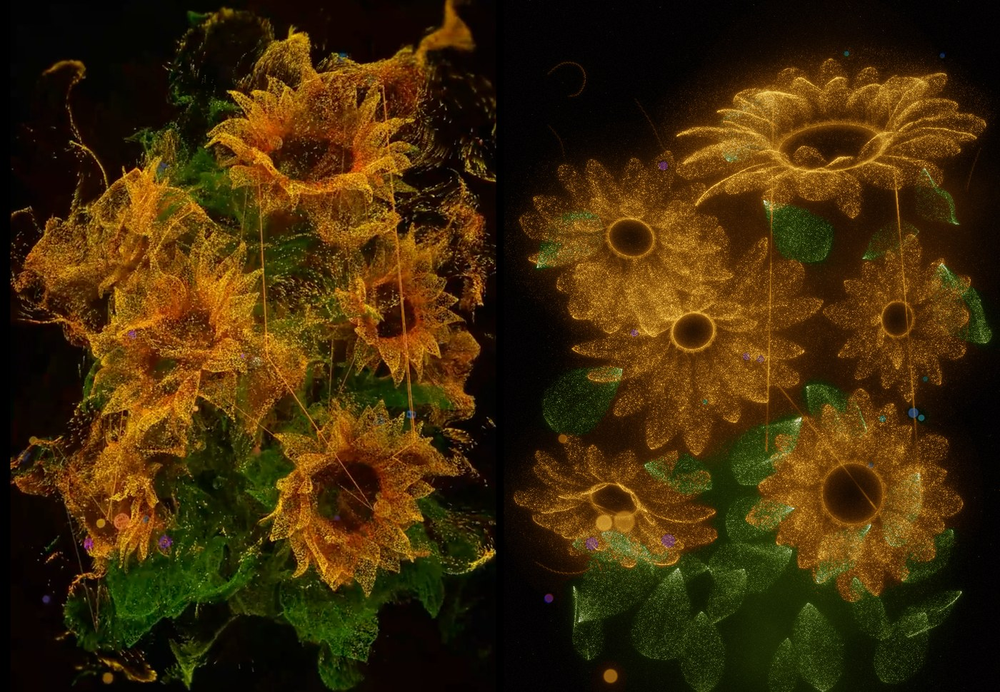

# Flower · 粒子向日葵 · TouchDesigner Flower 网页复刻

把参考图里那幅 TouchDesigner 粒子向日葵——六朵金色喷绘颗粒堆成的向日葵、翠绿叶片、细金丝线、紫蓝散景——用**原生 WebGL2** 重新做了一遍：**零依赖、零外部资源**，单文件 `index.html`（约 103 KB）双击即开。



> 左为参考图，右为网页在默认视角下的静帧（`?ui=0&t=20&still=1`）。原始参考图见 [`ref/reference.png`](ref/reference.png)。

## 怎么玩

- **默认视角 = 参考图构图**：六朵花的位置、花盘大小、倾角、花瓣长度都按参考图像素量出来定义，画幅是 5:7 的竖幅。
- **拖动**环视（带惯性）、**滚轮 / 双指**缩放、鼠标**视差**；闲置 5 秒后缓慢回到参考构图。
- `空格` 暂停 / 继续，`R` 回正，`S` 保存当前画面 PNG，`H` 隐藏界面；双击回正。右下角三个按钮对应暂停 / 回正 / 存图（鼠标动一下才出现）。
- 宽屏自动在左右补侧花与叶丛，长屏（手机竖屏）自动在上下补叶丛——核心 5:7 构图始终 1:1 居中。

## 画面是怎么来的

- **向日葵**：每朵花两层花瓣（外层长而平展、内层短而上扬），花瓣是带中脉、侧脉、放射纤维纹和飞白边缘的粒子面；花盘是会**遮挡**的深褐凹面网格 + 橙红边环；另有从花瓣外围出发、绕花轴旋出并朝镜头飘起的「飘散粒子」。
- **反馈拖尾**：整幅画面经时间常数衰减后与上一帧叠加（TouchDesigner feedback 的做法），花自转、飘散粒子运动、相机移动时都会留下暗橙色拖尾。
- **调色按参考图实测**：把参考图逐亮度带采样，发现它只有两条色阶——金色系从暗处的饱和红橙 (63,30,1) 走到亮处的淡金 (205,149,43)，绿色系从纯绿 (27,41,1) 走到黄绿 (149,161,99)。渲染时先加色合成线性 HDR，再按亮度查这两条曲线（紫/蓝/白散景走逐通道 filmic + 色差），所以花瓣基部自动是红橙、瓣尖自动是金绿。
- **氛围层**：雾团大面片（fbm 噪声）填充花与花之间，金色丝线与发丝卷线，橙色虚焦圆点与紫蓝散景，漂浮闪烁的尘埃，bloom、暗角、黑位抬升与胶片颗粒。

## 技术要点

- **原生 WebGL2，无任何库**：HDR（RGBA16F）场景 → 反馈拖尾 → 5 级降采样 + 帐篷上采样 bloom → 调色输出。无浮点渲染目标时自动退化为 RGBA8 编码。
- **粒子即采样器**：每个物体是一个独立随机采样器，粒子按序生成，所以画质档位直接截断每个物体的绘制数量（高 100% / 中 60% / 低 34%）；部位由每个粒子独立随机决定，任意截断都保持花瓣 / 花盘 / 飘散的比例。
- **点精灵能量守恒**：每个粒子的能量 = 强度 × 像素²，摊在点径圆盘上（亚像素至少 1 像素），点径变化不改变总亮度；景深只放大点径。
- **画幅适配**：参考图像素坐标 → 世界坐标按深度缩放，近处的花投影后仍等于参考图像素尺寸；视口超出 5:7 的方向才生成延伸内容，所以 5:7 视口下延伸粒子数为 0。
- **自适应画质**：帧耗时 EMA 超阈值先降内部渲染倍率、再降粒子档，富余时回升；`devicePixelRatio` 上限 2。
- **确定性**：同种子 + 同时间 → 逐字节相同的画面（`?t=12&still=1` 两次加载导出的 PNG 完全一致）。

## 目录

```
touchdesigner-flower/
├── index.html      # 构建产物：单文件，file:// 直接打开
├── build.py        # 打包：python3 build.py
├── src/            # util(随机/噪声/矩阵) · layout(构图数据) · gen(程序化生成) · shaders(GLSL) · camera · render · ui · main
├── test/           # run.mjs（node 逻辑回归）· ui-regress.js（ego-browser UI 回归）
├── ref/            # 参考图
└── shots/          # 预览与实拍
```

## 开发

```bash
cd touchdesigner-flower
python3 build.py            # 重新生成单文件 index.html
node test/run.mjs           # 纯逻辑回归
open index.html             # 或任意静态托管
ego-browser nodejs < test/ui-regress.js   # 浏览器回归（ego-lite）
```

URL 参数：`?t=20&still=1` 锁定时间渲染静帧、`?q=low|mid|high` 画质、`?seed=7` 种子、`?ui=0` 隐藏界面，以及任意调色参数（`exposure` `bloom` `trail` `grain` `vignette` `dof` `haze` `lines` `speed` …）。测试钩子 `window.__TF`：`state()` / `pause()` / `resume()` / `setTime()` / `step(n)` / `setQuality()` / `setParam()` / `snapshot()` / `resetView()`。

## 测试情况

- **逻辑回归**：`node test/run.mjs`，**56 项断言全绿**（随机/噪声/矩阵/四元数、构图数据自检、三种视口的画幅适配与延伸内容、生成数据自检与同种子逐位一致、粒子属性不变式、逐物体截断后粒子种类齐全、着色器源码约束、相机拖动/惯性/缩放上下限/闲置回正）。过程中抓到并修掉 1 个真 bug：粒子部位原按序号比例分配，低画质只画前 34% 时花朵只剩花瓣、花盘与飘散粒子全部丢失。
- **浏览器回归**（ego-lite，单 TaskSpace 复用 `p1`，`file://` 实测）：**49 项全绿**，控制台与 GL 全程零报错——加载/出帧/画面非黑、空格与按钮暂停继续、拖动偏转、滚轮缩放、回正按钮/双击/R 键、指针视差、H 隐藏界面、三档画质切换、参数校验、PNG 导出、`390×844` 手机竖屏（无溢出、六朵花全在画面内）、`1600×900` 宽屏、`844×390` 矮横屏、静帧确定性（两次加载逐字节一致）、URL 参数、aria 标签、零外链。
- **与参考图的数值比对**（996×1388 静帧，转 sRGB 后逐亮度带统计）：各亮度带色度与参考图一致（如 Y 45–70 带：渲染 (0.60,0.37,0.03) vs 参考 (0.58,0.39,0.03)）；分区平均亮度接近：顶花花瓣约 83 vs 74、左花簇 71 vs 74、右下花 72 vs 63、左下花 59 vs 55、底部叶片 42 vs 35、花间空隙 46 vs 62。
- **性能**：本机（Apple 芯片，硬件 WebGL）`1280×800` 实时模式 139 万粒子约 120 fps（帧耗时 EMA 8.3 ms）；`1600×900` 约 158 万粒子。

### 与参考图的差距（如实记录）

- 花瓣颗粒比参考图略柔：参考是视频帧里更碎、更锐的喷点，这里的景深与 bloom 让边缘更糊一些。
- 花盘边环比参考更规整；参考的边环是不规则的橙红绒毛。
- 花与花之间的雾比参考略暗（46 vs 62），参考图中间填得更满。
- 动态部分（自转速度、飘散轨迹、拖尾长度）是按 TouchDesigner 粒子花效果的常见做法推断的——手头只有这一张静帧，没有原始工程。

## 在线链接

尚未部署。
